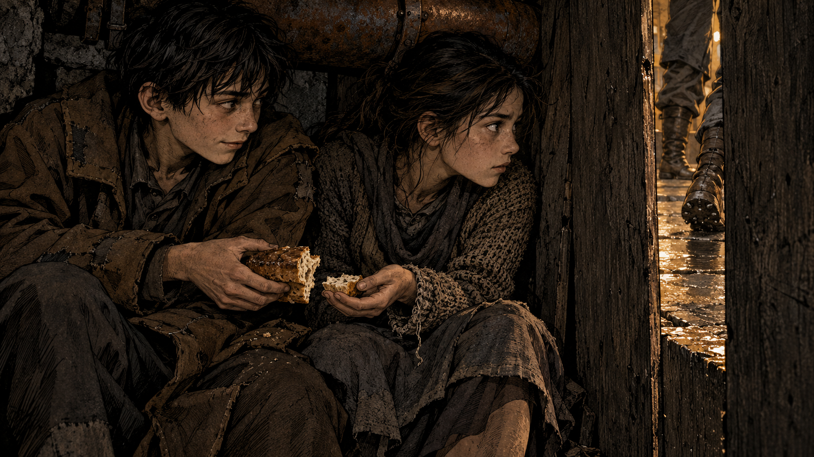

# Opening revision 4: P02_02, take 01

**Status:** Visual review only. Not approved character design, canon staging, final art, or a production asset mapped into the revision 3 shot ledger.

**Source:** [Opening revision 4 candidate](../../../../docs/SALVATION_OPENING_REVISION_4_CANDIDATE.md), Page 2, panel 2. The candidate's supplied title is The Thulans: Fortis; this does not rename the Salvation project.

## Generation record

- Generator: connected image-generation tool in this Codex session. This image was not rendered through Panel Studio's local AGY provider or generated by the new preset itself.
- Output: `take-01.png`, 1672 x 941 pixels. Original retained in the session's generated-images directory.
- SHA256: `41e0f7d89e21650cab3ce407f3d484cc594c1304bc35dad9e3fd3c1f2c4fd527`.
- Scene brief: one wide ink-and-crosshatching panel; two human teenage siblings behind two screening boards beneath a warm return pipe; patrol boots visible through a vertical gap; Ansen quietly exchanging two unequal pieces of one loaf below the gap while Nessa watches the patrol. Ansen wears his oversized coat; Nessa has not yet joined him under it. Muted soot-grey, brown and amber; no lettering, powered frames, helmets, armoured giant, or outside sky. This is a descriptive brief, not an exact export of the generation prompt.

## Review observations

Faces, ordinary human bodies, the return pipe, boards, bread, and the passing patrol are readable. The exchange itself is less clear: it can read as two siblings already holding their portions. A later take should strengthen the hand-to-hand exchange. The gap and the patrol's sightline require blocking before claiming the hiding place works. Character appearances, ages, clothes, and architectural details in this generated take remain provisional.

## Engine change and verification

Panel Studio now offers `civilian_shelter` alongside its unchanged default `mastercraft` equipment treatment. The civilian treatment retains underground industrial materials and ink style without injecting helmets, pressure suits, mantlets, or hydraulic equipment into every positive prompt. The UI keeps the editable scene separate and applies its selected treatment once at generation time. The synthesis API accepts `options.sceneProfile`; the generation API accepts `sceneProfile`. Unknown profiles return an error.

The local AGY executable is absent in this cloud environment. Its launch failure now returns a generation error instead of an unhandled child-process error. Other image providers still require their own configuration; the connected Codex image tool is not wired into the local server.

Verification: Panel Studio's test command passed, direct assertions checked civilian/default treatment and missing-generator handling, browser/server JavaScript syntax passed, and local HTTP checks exercised synthesis, the scene selector, invalid-profile rejection, and missing-AGY failure without stopping the server. No paid provider call or successful local end-to-end generation was claimed.
