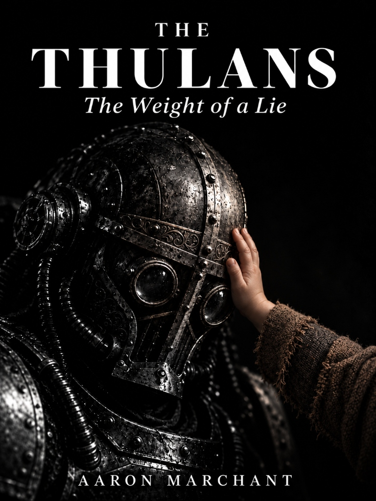

# The Thulans: The Weight of a Lie
*A prologue and twelve-chapter industrial grimdark novella of manufactured faith and sacrifice by Aaron Marchant.*

  

## Logline
In a subterranean mountain city where the state stages miracles to extract voluntary human sacrifices, an aging rescuer sealed inside a hydraulic iron frame discovers the water reserve was full two days before a boy died to "earn" it. His decision to expose the truth does not free the city—it destroys the one lie keeping 4.2 million people alive.

## World Primer
- **The Enclosure**: Four point two million people live stacked in vertical industrial tiers inside *Fairguni*, a failing hollow mountain with no sky, no outside, and failing rock.
- **The Manufactured Miracles**: Facing exhaustion, the Council hides surveyor water and ore finds until desperate citizens surrender their lives in the Life Tithe to "earn" the release.
- **The Escape Arithmetic**: The Council is secretly constructing six generational arks on the slips that fit only one person in seven; the rescuer's truth shatters the city's final illusion.

## Cast of Six (The Naming Gate)
- **Varek**: An old rescuer sealed three centuries ago in a three-tonne hydraulic iron frame; bound by duty to stand between workers and falling stone.
- **Wulfila**: A nineteen-year-old from Azg-Haíms who surrenders his life in the Life Tithe, honestly believing his sacrifice buys water for his family.
- **Sanna**: Wulfila's sister; runs the Lower Four nursery, conducts domestic triage, and keeps the survivors alive through the flood.
- **Bram**: Wulfila's fourteen-year-old brother; salvages coupling bolts in the dark drifts and recovers the hidden survey slate proving the lie.
- **Haila**: Wulfila's betrothed; tied the ceremonial hemp hammer-ring that marked him for the gallows leap.
- **Theodemir**: The Council's executive numbers man; convinced that survival arithmetic overrides mercy or truth.

## Pronunciation
| Name | Phonetic Key |
| :--- | :--- |
| **Varek** | VAIR-ek |
| **Fairguni** | FAIR-gun-ee |
| **Wulfila** | WUL-fil-a |
| **Sanna** | SAHN-na |
| **Bram** | BRAM |
| **Haila** | HIGH-la |
| **Theodemir** | THEE-oh-dem-eer |

## Chapters & Structure

### Prologue
- [Prologue: The Choir-Gate](prologue.md) (530 words) — Tier Six Gantry. Varek stands witness as Wulfila leaps for the water ledger.

### Act I: The Tithe & The Proof
- [Chapter 01: The Flange & The Pine Sprig](chapter_01.md) (1,036 words) — Bram and Kaelen salvage coupling bolts; Wulfila's hidden brass chit is recovered.
- [Chapter 02: The Nursery in Lower Four](chapter_02.md) (1,352 words) — Sanna takes responsibility for the pump repair; Odo reduces the household allowance.
- [Chapter 03: The Memory of the Leap](chapter_03.md) (1,686 words) — Bram retrieves the survey slate from Wulfila's locker; the sacrifice is remembered.

### Act II: The Rupture & Drift 14
- [Chapter 04: The Acoustic Trace](chapter_04.md) (1,954 words) — Varek breaks his post after the seismic rupture; his breach sends water toward Lower Four.
- [Chapter 05: The Shoring of Drift 14](chapter_05.md) (1,354 words) — The crew shores the roof, learns the ark berth totals, and opens the clean feeder.
- [Chapter 06: The Welded Advance](chapter_06.md) (**revised 29 October 2026; word count to be recalculated**) — Bram cuts the fuse; Varek disables the hulking breakers, opens Ansen's chest cage and helps free both prisoners, and kills the guard aiming at Bram.

### Act III: The Ascent & The Office
- [Chapter 07: The Ascent](chapter_07.md) (2,530 words) — The nursery trades steam for Varek's loading pressure; a stone cage lifts him to Tier Nine.
- [Chapter 08: The Office on Tier Nine](chapter_08.md) (2,483 words) — Theodemir verifies the sounding, adds Wulfila's name, and signs the feeder-closure order.
- [Chapter 09: The Hammer Falls](chapter_09.md) (1,721 words) — Varek drops the maul, descends by gravity cage, and returns by machinery trolley.

### Act IV: The Opening & The Residue
- [Chapter 10: Bring the Wrenches](chapter_10.md) (2,368 words) — The crew removes the rescue pump and opens the frame with Varek's consent.
- [Chapter 11: Skin Against Skin](chapter_11.md) (1,973 words) — Varek is lifted free, carried through the wash passage, and dies holding Sanna's hand.
- [Chapter 12: Our Iron Anyway](chapter_12.md) (2,059 words) — Bram preserves the evidence; the state claims Varek's memory; the pump remains in use.

---

## Authoritative Mirrors
- **Complete Omnibus Manuscript**: [THE_THULANS_MANUSCRIPT_COMPLETE.md](THE_THULANS_MANUSCRIPT_COMPLETE.md) (historical multi-date mirror; Chapter Six revised 29 October 2026; word count awaiting a complete recount)
- **Live Illustrated Reading Draft**: [Google Doc](https://docs.google.com/document/d/1UioMeG59Kw7xE6XvxoLRXy0SbkTXwg-6ktSO5QL2cpY)
- **Narrative Architecture**: [`../docs/NOVELLA_BLUEPRINT.md`](../docs/NOVELLA_BLUEPRINT.md)
- **Voice Contract**: [`../docs/THULAN_NOVELLA_VOICE_CONTRACT.md`](../docs/THULAN_NOVELLA_VOICE_CONTRACT.md)
- **Handoff & Prefix**: [`../handoff/PREFIX.md`](../handoff/PREFIX.md)
