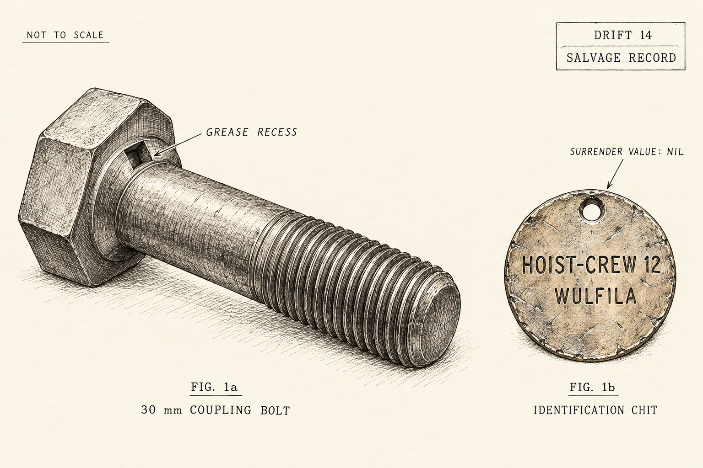
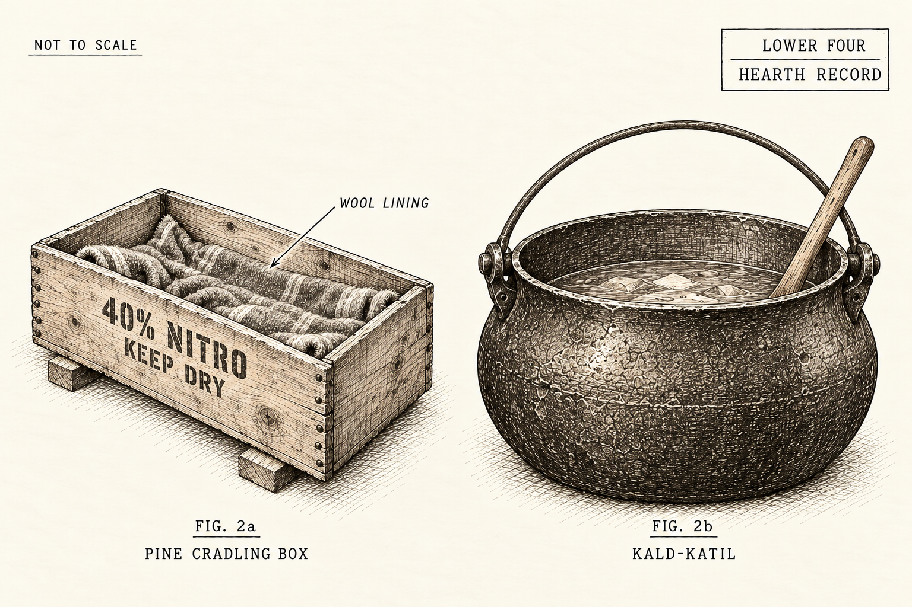
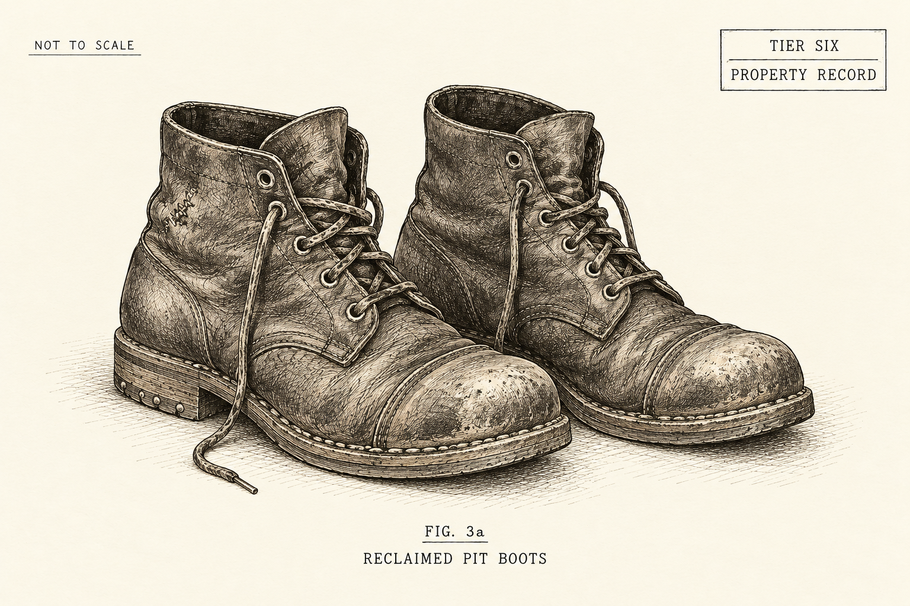
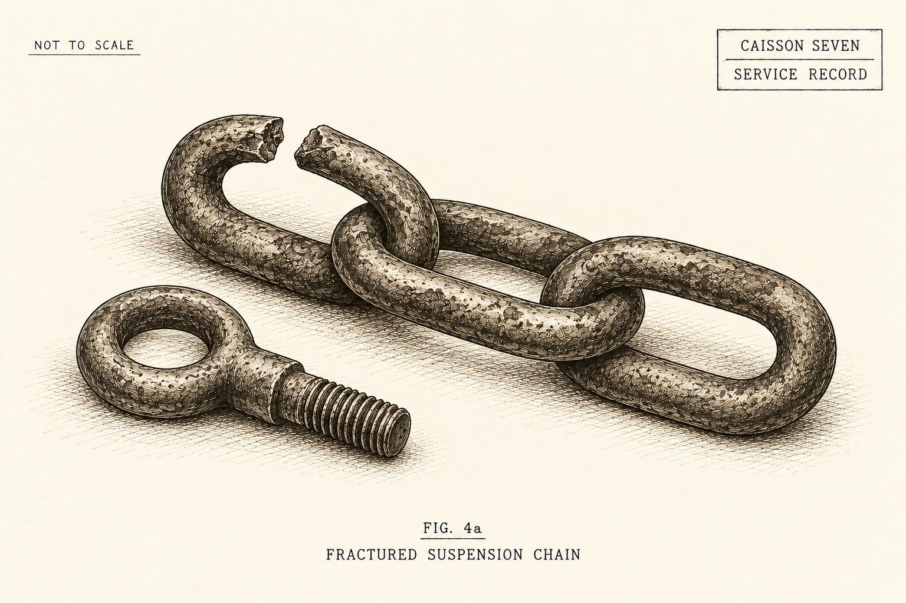
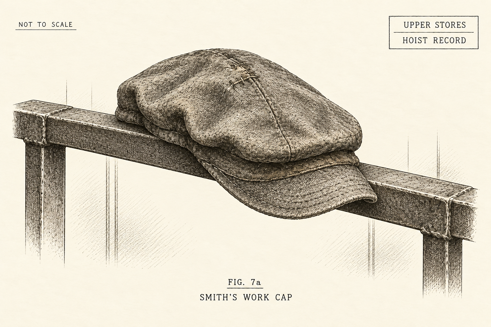
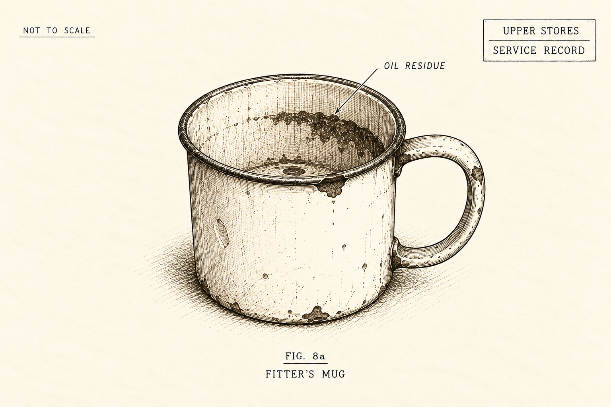
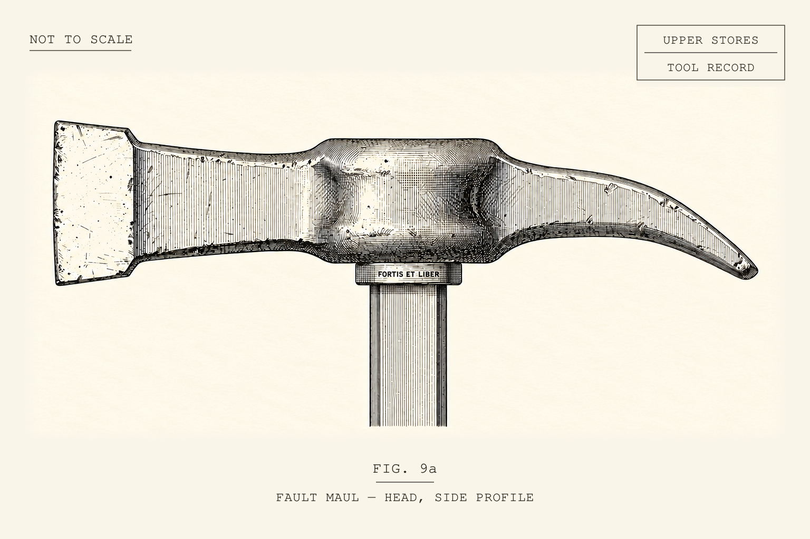
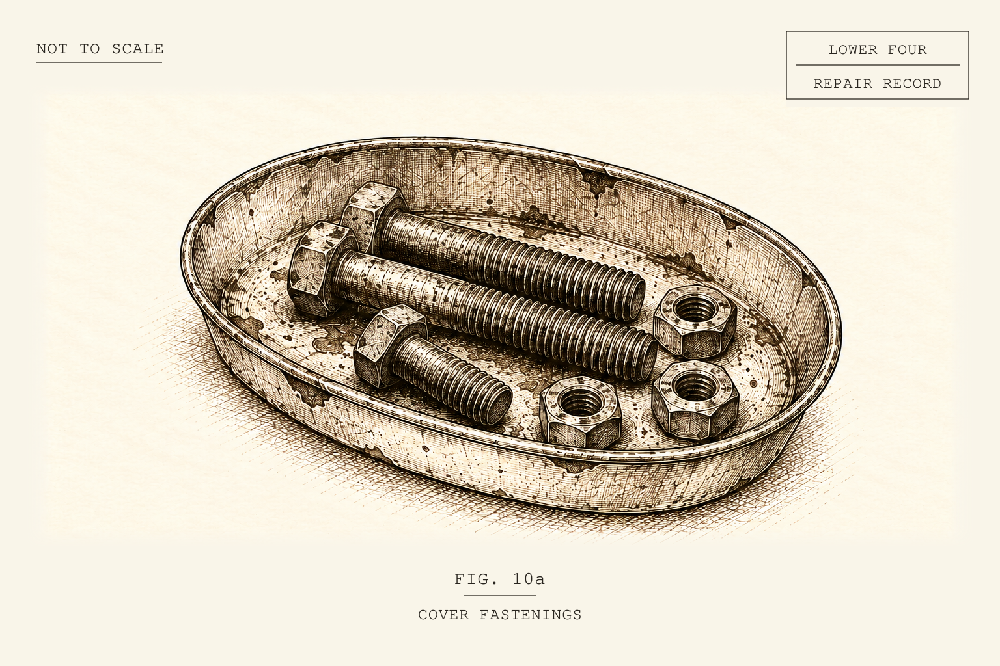
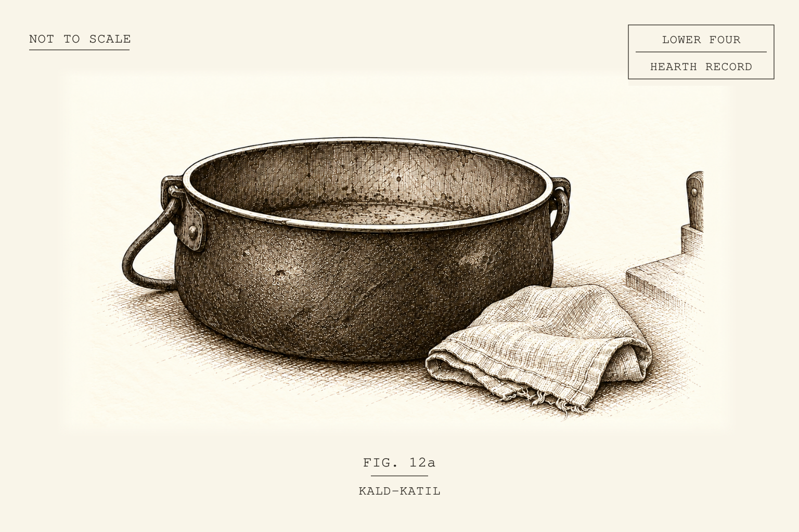

# THE THULANS
## The Weight of a Lie

**Aaron Marchant**

  

---

### PROLOGUE: The Choir-Gate

Tier Six Gantry. The twelfth of September.

They bolted him to the choir-gate before the first shift bell. Four men and a bailiff. Six bolts through the bronze hip-pins, each one tested with a thumb. The pins rang under the wrenches.

“The frame will stand,” the bailiff said. “It has no leave to speak.”

Varek did not answer. Words cost air, and the small engine at his back had none to spare. His boiler was banked to a whisper. Somebody had thought of that. Steam would spoil the hymn.

Two clerks came to the gate while the crowd was still on the ladders. They stood on the far side of the iron, out of the draught, and read figures to each other from a folded sheet. Hulls. Berths. Dates for loading. They spoke the way men speak beside a stove. A frame is not a man. A frame does not listen.

Varek listened. He had nothing else to do with the morning. He kept the figures. He kept everything.

Then two thousand came in and filled the tier below, and he heard them the way he heard rock. Boots. Coughs. A baby. The scrape of hemp under rope-burned hands. The Volcanic Shear breathed sulfur up out of thirty feet of dark. The shutters clicked aside on his lenses. Two pale beams, faintly green, lay across the grating.

Three men in polished helmets raised straight brass trumpets and blew one flat chord.

The boy came onto the drop-plate barefoot. Nineteen. Coal in the creases of his toes. A hemp cord at his neck, braided even and tight by someone who loved him. In his right palm sat a ring of scrap iron no bigger than a thumb joint.

The boy shifted his bare feet against the drop-plate. Each small scrape passed through the gantry and the choir-gate, down the bolts to Varek’s hip-pins. One foot, then the other. Faster now. He counted the movements. It was the only work left to him.

Sub-Deacon Milo unrolled the roll and read. Forty-one winters of barley meal. Forty-one winters of lamp tallow. Forty-one winters of sweet water, returned to the ledger of Fairguni.

“Brothar Varek stands witness,” Milo said.

Two thousand faces turned to the gate. The iron gave them nothing. They took it for leave.

The boy looked back once across the hemp rope. Not at Milo. Past a weeping girl, past the rope, down to a child’s height, where a sprig of dried pine was pinned to a woman’s apron. The child’s mouth was open. His knees were locked.

Then the boy’s right thumb tapped his thigh. Twice.

Varek knew it. Three hundred years in the mine, and he knew every sign the hoist-men used. Two taps. Pin seated. Clear to haul.

There was no tub on the Gantry. There was nothing to haul.

He turned his lenses toward the child. The bolts let him turn a hand’s width.

The clerk pulled the pin on the drop-lever. The iron doors clacked open. Sulfur steam climbed through the gap. Nobody screamed. The small scrapes stopped coming through the bolts.

The clerk made one mark on his slate.

Varek heard the chalk. One stroke.

---

## ACT I: THE SUMP & THE SUNDAY LIE

  

---

### CHAPTER ONE: The Flange & The Pine Sprig

Bram had wrapped tarred hemp around his right thumb to keep the cracks in his skin from bleeding into the grease tub.

He knelt beneath the rails, holding the wooden tub under the joint Kaelen was breaking loose. Each hammer blow shook the timber under his knee. He had watched this joint all morning. It was the one Wulfila had named.

“Keep the tub under the lip,” Kaelen said.

The smith had set his chisel against a rusted nut on the bar joining two lengths of track. His cheek was almost against the rail as he watched the cut deepen. A stub of tallow candle hung between his front teeth, dripping wax onto his jacket.

“If that nut drops in the ditch, you’re diving for it before shift bell,” he muttered around the candle. “I’m not shorting the tally for your blue fingers.”

“I have it.”

Bram shifted his knee on the wet timber.

“Air still drawing?”

He checked the strip of sacking tied to a roof nail. Its loose end lifted toward the haulage shaft.

“Yes.”

Sanna’s apron lay across his knees. Before he left Lower Four, she had tucked a dried sprig of mountain pine behind the third brass pin. The needles were bruised nearly black, but when he bent over the tub he caught their faint, dry scent—the smell of wood that had grown in sunlight. Nothing else in the drift smelled like that.

Kaelen struck again. The nut split, and the crack rang back from the low roof.

He pried it loose and dropped it into the tub, then drove his punch against the end of the coupling bolt. On the third blow, the bolt broke free. Tallow splashed from behind its head onto Bram’s cheek.

Bram scraped it off with his thumbnail and wiped it back into the tub. Clean grease cost half a copper token at the hoist house.

He pulled the scraper from his boot and worked it beneath the bolt’s head, picking stiff yellow grease from the recess. Brass showed through. He cleared enough to read the name.

HOIST-CREW 12 — WULFILA.

His brother’s chit should have gone back to the Council when he died, to close his tool-account. Keeping it after the funeral bell meant four pints taken from the household’s water ration. It didn’t matter whether it had been stolen or found.

Wulfila had told him to show Kaelen.

Footsteps came along the haulage way. Bram slid the chit behind the pins of Sanna’s apron. The cold brass stung through his undershirt.

Kaelen shifted his knee between Bram and the passing workers. Bram kept his hand against the metal until their footsteps faded, then drew it out far enough for the smith to see the name.

Kaelen pressed his hand back against the apron.

“Keep it there.”

“Scrape the shank clean,” Kaelen said, his knee cracking as he leaned forward. “They dock us if there’s grit on the scale.”

Bram set the scraper to the shank and worked the black scale off the bolt until gray metal showed. Cold shook his hands, but he kept the strokes even. Back in Lower Four, six babies coughed in empty dynamite crates beside the drain. Sanna had spent the night boiling wild leek roots over coal clinkers, trying to put enough steam into the air to ease their breathing. Four sound bolts would buy forty pounds of dry larch kindling. Dry wood meant less sulfur smoke around the cradles.

“Kaelen?” Bram asked, his scraper clicking rhythmically against the metal.

“Work the iron, boy.”

“My brother Wulfila—”

“Wulfila’s gone,” the smith said, setting his punch on the second bolt. “Don’t talk about dead men while I’m holding cold steel.”

“He told me the grease in the old flanges came from animals. He said they had beasts on the surface as big as haulage tubs, covered in brown hair, that ate grass under the open sky.”

Kaelen stopped. The four-pound hammer rested on his thigh, its hickory handle stained black by forty years of palm oil. He reached up, took the tallow stub from his teeth, and stuck it into a split in the timber prop above his ear. In the yellow light, the scar across the bridge of his nose looked like purple cord.

“Wulfila was nineteen and his head was full of women and old songs,” Kaelen muttered, wiping wax off his lip. “I’ve never seen a beast like that. There’s what the hoist sends down, and what the Council weighs. Now hold the tub. This one’s loose.”

Before he struck again, Kaelen laid his knuckles against the roof timber.

Resin had squeezed from a knot beside the iron collar. The yellow bead trembled. A thin groan passed through the timber into the rail. Kaelen held the hammer still until it faded.

“She’s talking,” Bram muttered, pulling his knees tighter to his chest.

“She’s settling,” Kaelen said. “Keep still. I’ll tap it through.”

He shortened his grip on the hammer. Tink. Tink. Tink.

Each tap knocked loose a flake of orange scale. Hot iron and burned lard stung the air. Beneath the hammer’s rhythm came another sound. Bram felt it through his boots and saw it tremble in the ditch water: thrum-thrum-thrum. Not a pick. Not a haulage winch. Something was moving steadily behind a wall that should have held nothing but dry stone.

Kaelen stopped with the hammer an inch above the punch and turned toward the wet rock wall.

“Kaelen?”

“Quiet.”

Kaelen pressed his bare palm against the wall. The tip of his ring finger was missing; Bram could see the old white scar as the hand spread over the stone.

Bram reached past Kaelen’s sleeve.

The stone was warm. He kept his palm against it, feeling the steady thrum through his fingers.

Far below, the First Bell struck.

The clang rolled up the haulage shaft. Kaelen’s hammer remained still. Bram listened until the last stroke faded.

Kaelen took his hand from the wall. His grip whitened around the hammer handle.

“Wipe your face, Bram,” the smith said. “We’ll finish this joint, then see what your brother left in the locker.”

  

---

### CHAPTER TWO: The Nursery in Lower Four

Lower Hearth Four lay fifteen feet below the haulage drift. When water came down from the mine, it reached the nursery first.

The nursery smelled of wet sacking, carbolic wash, and sulfur smoke. Six infants lay in three wooden crates raised above the floor on rotting larch ties. The crates came from the Tier Five powder magazine; their sides still warned: 40% NITRO — KEEP DRY — COCKOS DYNAMITE CO. Under old wool flannel, the babies breathed in thin whistles against the damp rock.

Beside the stove, old Marta stirred lentils and turnip skins in the Kald-Katil, the iron kettle that had simmered on Hearth Four for generations. Seven-year-old Elin rocked the middle crate with her clog. Marta ladled broth into a chipped enamel cup, wiped its rim with clean linen, and set it beside the stove.

Above the flue, charcoal still showed where Sanna had scrubbed the whitewash before dawn: SIX HULLS FOR THE SPIRE / SLAG FOR LOWER FOUR.

Sanna was eighteen. She knelt in greasy ditch water, a long monkey wrench gripped in both hands. Her sleeves were rolled above arms marked by machine grease and lye burns.

Between her boots, the nursery pump struggled to keep the water down. A crack ran along its cast-iron housing. Each stroke of the rocker arm forced another bubbling ribbon of brown water through the split.

“The crack’s widening,” she said. Her voice stayed steady, though her breath came short and white. “The piston’s scraping inside. If that casing gives way before shift bell, the water will cover the duckboards in twenty minutes.”

Across the room, Bailiff Odo stood dry on a stone bench beside the stove. His heavy gaiters were buttoned tight and almost spotless. He held a wooden tally board under one arm and a stub of chalk in the other hand, his fingers wrapped in paper tape against the biting lime.

“The Fourth Tier foundries have first claim,” Odo said, looking at the ration slate. “The Spire shipyards took two thousand tonnes of plate this month. The foundries lost three molds on the waterworks. Every pound of salvage goes upward.”

“The foundries aren’t drowning.” Sanna hauled on the wrench. It slipped and stripped rust from the nut. “Give us two pounds of lead to bind this crack. Two pounds. That’s all.”

“Lead is restricted to line-couplings,” Odo said. He raised the chalk.

With two clean strokes, he drew a line through the numeral 8 chalked on the post. Beneath it, in neat, small script, he wrote 6.

“Six pints per hearth from third bell,” Odo said. “Pressure’s down in the feeder main. The Spire has ordered another restriction across the Lower Hearths.”

Sanna dropped the wrench into the mud with a hollow splash. She stood up, her skirt heavy with ditch water, her red hands hanging at her sides.

“Wulfila surrendered forty days ago,” she said. “He was nineteen. The Sub-Deacon signed in front of two thousand witnesses.” She pointed to the crossed-out eight. “Eight pints for our hearth, for as long as it stands. That was the promise.”

Odo tapped the chalk against the side of his nose, then blew a speck of white dust off his tally board.

“Your exemption was assigned to the third-tier feeder,” the bailiff said mildly. “That pipe was taken out of service on the nineteenth of October. When a delivery point closes, the exemptions tied to it lapse until they are reassigned. File a transfer petition at the Second Desk on Tier Eight.”

“Only the tap closed,” Sanna said. “Our hearth’s still here.” She looked at the chalk. “The Second Desk is two tiers above us. The petition costs four copper bits. We don’t have four bits, Odo.”

Odo turned the chalk stub in his taped fingers.

“I draw four pints of gray sump water at the clerk’s billet on Tier Seven, girl,” Odo said. His voice was flat, neither cruel nor kind. “It smells of dead minnows and old hemp. You think the Archon pours mountain melt down my neck because I carry a board? The rule is the same for everyone. The Ministry does not alter arithmetic for local convenience.”

The timbers at the entryway groaned.

Kaelen walked through the low doorway, his four-pound sledge resting across his shoulder. Bram followed two paces behind, his head down, holding the firkin by its wire handle with both arms.

Odo glanced at the tub. “Scrap recovery?”

“Four coupling bolts from the rails,” Kaelen said, dropping his tool kit onto the bench with an iron crash that made Odo step back. “Eight pounds. Take the tally and get out of my drift.”

Odo chalked eight pounds onto his board. “The foundry expects ten.”

“Then the foundry can come down here and chip the two pounds out of my bad hip,” Kaelen growled. He looked down at the spewing pump casing, then up at Odo’s dry gaiters.

“A curved pine stave, wrapped tight with wire, might hold that crack to a trickle for three or four hours,” Kaelen said, his eyes still on Odo.

Odo adjusted the board under his arm. “Uninspected repair to municipal equipment. I’ll enter it as a bypass.”

“Log it in your boots,” Kaelen said.

Odo turned and walked out through the low timber frame into the haulage crosscut. His clean boots clicked rhythmically against the dry stone until the dark swallowed the sound.

When the leather door fell shut, Kaelen’s shoulders sagged. He knelt beside the pump, stopped its drive, and opened the little drain. Rusty water ran into the gutter. The spray from the cracked housing subsided.

“The barrel stave by the brazier, boy.” Kaelen felt along the crack. “Canvas first, then wood, then wire. Wood spreads the strain. Wire alone would crush what’s left.”

Sanna brought the tallow pot. She set it within Kaelen’s reach, then took the wire from Bram.

“Strap it,” she said. “Put my name against the repair.”

Bram passed the split pine stave.

They wrapped canvas over the crack and pressed the curved stave against it. Kaelen bound the housing with wire, slipped a short stick through the loops, and twisted until the wood held tight.

The wire bit into the stave. A little water still seeped beneath it.

“Bram. If that patch starts spraying?”

“Stop the drive.”

“And open the drain. Leave the wire alone till it’s empty.”

Kaelen closed the drain and restarted the pump. Its rocker rose and fell. Slowly, the water around Sanna’s shins began to sink.

Marta held out the chipped cup to Bram. He took one mouthful of broth, then carried it to Sanna. She drank with both hands still cupped around his, warming her fingers against the tin.

When she lowered the cup, she reached for the knot around his thumb.

“Don’t. It’ll come loose.”

“I’ll tie it again.”

“I can tie it.”

Her fingers stayed beneath his hand.

“After shift,” he said.

She let him take it away.

Their mother had wiped the rim too, even when supper was one cup passed between them. Keeping a Thulan table, she called it. Bram turned the handle toward Marta before he gave the cup back.

Kaelen wiped his nose on his greasy sleeve and stood up, leaning against the timber upright to catch his breath.

“That buys four hours,” Kaelen muttered. “Get the crates onto the raised stone bench. Then find out whether the hoist can take them to Tier Five.”

“Marta, blankets first,” Sanna said. “Elin, fetch the dry sacking.”

Sanna knelt beside the nearest crate. A damp sleeve was trapped beneath one child’s back; she eased it free before lifting the baby against the dry cloth at her collar. The little hand opened against her neck. She held still until Elin brought the sacking.

Kaelen reached out, caught Bram by the shoulder, and pulled him toward the door.

“Leave the tub with your sister, Bram,” the smith said low. “Keep that chit hidden. They’ve opened the locker house for the rail-clearance crew. We can get in before the watchman changes.”

  

---

### CHAPTER THREE: The Memory of the Leap

The outer gate of the Tier Six locker house stood open for the rail-clearance crew. Since the survey slate went missing, it had admitted only the bailiff’s clerks. Now their crowbar lay beside the broken hasp. Kaelen led Bram through while the watchman was at the tally desk.

Bram stood in the doorway with a candle cupped in one hand. Sawdust and dead moth wings covered the floor. The room smelled of old leather, vinegar, and the sour wool of miners who no longer came back. Forty numbered wooden cubbies lined the limestone wall. Half hung open on broken leather hinges.

Cubby 12-09 was at eye level near the back corner.

Kaelen knew which box to look for. He leaned against the upright, easing his bad knee, and watched Bram reach into the empty locker.

The clerks had taken everything from the shelf: Wulfila’s spare boots, his dented mess tin, his horn spoon, even the grease pot he’d carved from an old pick handle. Whatever the sale brought went against the lime they threw down the shaft after him.

Bram pulled Wulfila’s brass chit out from behind his sister’s apron bib. His thumb rubbed the square hole punched through the center, right between the 12 and the W.

“He said his spare boots were here,” Bram whispered. “Only one season on the heels. When I turn fourteen on the thirtieth, I could put sacking in the toes and wear them.”

“Clerks don’t leave leather behind,” Kaelen said, his eyes fixed on the dark crack under the locker-house door where the draft pulled toward the main shaft. “Leather’s worth four copper tokens a pair to the cobbler on Tier Seven. Hurry up, boy. If the watchman comes round the corner with his dog, we’re both going in the cage.”

Bram didn’t pull his hand back. He slid his cold fingers up the inside of the pine wall, past the rusted nail where Wulfila used to hang his wet neck-rag, until his knuckles bumped the split pine cleat near the top board.

The wood was tacky with black coal-tar—the same stiff, tarred seam Wulfila had made him swear to look for the night before they took his boots.

Bram closed his eyes in the dark, and the smell of the tar turned back into the smell of the ember-pan in Bunkhouse Twelve.

“Hold the light closer, Bram,” Wulfila had whispered that night, sitting on the edge of the lower straw tick with his heavy pit-boots already unlaced beside the door.

Across the room, Sanna knelt at the dry tap, scraping the bottom of the water barrel with a horn cup. The bailiff had nailed the order to their doorpost: HEARTH 12 — CONDEMNED TO DRY-CUT (2 PINTS). Two pints would not wet barley meal for three mouths, much less keep steam around the babies. They had forty-eight hours to pay the arrears or send an able-bodied timberman to the Tithe Gantry. That sacrifice would buy the family an eight-pint water exemption.

“Kaelen says the north cistern isn’t empty,” Sanna had said, her back rigid as she set the dry cup down. “He says the hoist-men heard water behind Shaft 44 yesterday.”

“It isn’t empty,” Wulfila said. “Yesterday I lowered a sounding line into the Shaft 44 standpipe. It came up wet.”

Sanna looked at the dry cup. “Then show Odo.”

“The main gate’s locked. The key stays on Tier Eight. I took the survey slate from the surveyor’s dropped satchel, but I can’t read the clerk-marks. Odo would call it stolen before anyone listened.”

“Show Kaelen.”

“I hid it in my locker before they searched us. They’ve sealed the whole house. Even the living men have to collect their tools through the watchman.”

Sanna looked at him.

“By the time we get it out, our forty-eight hours will be gone.”

Wulfila touched the ration order nailed to the doorpost.

“But the Gantry is witnessed. When the clerk takes my remaining years, he has to write eight pints into the book for our hearth. Not a promise from Odo. A mark in their own ledger.”

He put the sprig of mountain pine into Bram’s hand. His fingers were shaking.

“The clearance board says October,” Wulfila told Bram. “They open the locker house when they strip that rail. I put my chit in the coupling before shift ended. When Kaelen finds it, show him which locker. Behind the top cleat, under the tar. Go in with the crew. Don’t let them see what you take.”

Bram closed his hand around the pine.

“Will it get us more water?”

“I don’t know. Keep it anyway.”

On the Gantry next morning, three men in polished helmets blew a long, flat chord on straight brass trumpets.

Wulfila stood barefoot on the drop-plate. The bailiff had taken his pit boots at the choir-stall door and credited their leather to the Council. His feet were pale against the oiled iron grating, their knuckles blackened by coal. Beside him, Haila had braided the hemp cord now hanging from his neck. Her hands shook as she pressed an iron hammer-ring into his palm—the betrothal token they had forged from scrap behind the smelter flues.

Behind them, Varek Fairgunjis—the Brothar—stood bolted to the choir-gate in his eight-foot iron walking cage. The twin quartz lenses stared over the crowd, blind and still. Kaelen’s grandfather had cast the bronze hip-pins in Foundry Three.

“Thulan of the Old Hearths,” their father used to call him. A Thulan stayed until the others were clear. Bram looked at the iron hands beside the choir-gate. Neither moved.

“By the measure of his remaining years,” Sub-Deacon Milo’s voice had rung out across the thirty-foot gap of the Volcanic Shear, while the clerk stood beside him with a wooden slate, “forty-one winters of barley meal, forty-one winters of lamp tallow, forty-one winters of sweet water—freely returned to the ledger of Fairguni by Wulfila of Azg-Haíms, Badge Twelve-Nine, so that the hearth of his blood may drink full measure while the stone endures.”

Wulfila had looked back across the hemp rope once. He hadn’t looked at the Sub-Deacon. He had looked past Haila’s weeping face, straight down at Bram’s knees where the dried pine sprig was pinned to Sanna’s apron, and tapped his right thumb twice against his thigh—the hoist-man’s signal that the coupling pin was seated home and the tub was clear to haul.

Then the clerk pulled the iron pin on the drop-lever.

There was no scream. The iron doors clacked open, sulfur steam rose through the gap, and the clerk made one mark on his slate.

That evening, Sanna had set Wulfila’s eating slate face-down at the head of the board. Bram sat beside it through supper.

Haila had brought the scarf Wulfila had left with her. She spread it across her knees, with one finger through a burn hole.

“I told him not to dry it on the stove.”

“He said a coal spat,” Bram said.

“There was always a coal.”

Bram laughed before he could stop himself. He looked at Sanna, but she was watching Haila.

When Marta came to take the bowls, he lifted his brother’s slate himself.

Two days later, Tap Twelve ran clear. On the fourth day the roof over their bunkhouse collapsed and buried it. On the sixth, Odo drafted thirteen-year-old Bram onto the salvage crew to pay what remained of Wulfila’s funeral charge.

In the cold dark of the Tier Six locker house, Bram jammed the corner of Wulfila’s brass chit into the tarred seam behind the top cleat and pried downward.

The pine sliver gave with a soft pop. Something flat, heavy, and cold slid down out of the gap and struck the knuckles of Bram’s left hand.

It was a broken piece of gray roofing slate, roughly the size of Bram’s hand. Hardened red tally-wax covered one face. Cut into it was the crossed-calipers seal of the Tier Nine Continuity Board.

Kaelen took the candle from Bram and held it close to the wax.

On the bare back of the slate, someone had scratched two words: KEEP THIS. Kaelen turned it toward the flame. The crooked K was the same one Wulfila used on the tool-crib tallies. His thumb stopped beside it. He turned the slate face up again without speaking.

“Kaelen?” Bram whispered. “Can you read it?”

“I can read a tally, boy. Some of their clerk-words take me longer.” Kaelen brought the light closer. “But I know pipe marks. Every smith on the mains has to learn those.”

Kaelen pointed at three marks in the wax: a double 4 inside a square, a triangle crossed by a plumb line, and a notch labeled +18 FT OVERFLOW WEIR.

“That square is Shaft 44—right behind the warm rock where we pulled the rail coupling today,” Kaelen whispered. “The triangle marks the North Cistern sounding line. The surveyor entered the reading on the tenth of September.”

“Wulfila lowered a line there,” Bram said. “He told me it came up wet. He jumped on the twelfth—forty days ago. The Sub-Deacon had already read out that the North Cistern was dry to the mud.”

“It wasn’t dry.” Kaelen gripped the slate. “Look here, boy. The water stood eighteen feet above the spillway two days before Wulfila died. They didn’t close Lower Four because the cistern had failed. Someone shut the bronze gate at Shaft 44 and locked the water behind the wall.”

Out in the main haulage gallery beyond the locker-house door, the iron gate at the top of the Tier Six ladder clanged shut. The heavy, rhythmic clink-clink of a watchman’s hobnails started down the stone flags toward them, accompanied by the low, wet snuffle of a pit-mastiff on a chain lead.

Kaelen pinched the tallow wick out between his callused fingers, plunging the locker house into pitch dark, and shoved the broken survey slate deep inside the breast of Bram’s tunic, right behind the brass pins of his sister’s apron.

“Coal-chute. Behind the salt barrels.” Kaelen pushed him toward it. “Keep the seal covered. They hanged a man for taking a page from the ration book.”

---

## ACT II: THE TWO LEDGERS

  

---

### CHAPTER FOUR: The Acoustic Trace

“Break it under your heel,” Sanna said.

She had lifted the kettle from the brazier, wrapping her sacking skirt around its hot handle. At the far end of the bunkhouse, the stave Kaelen had strapped over the nursery pump’s crack was still holding. Water slipped through the wire in a slow drip-tap-drip into the gutter.

On the upside-down pine crate between them lay the broken piece of Tier Nine roofing slate, the red wax gleaming dull and wet in the tallow light.

“Break the wax and it’s only roofing slate,” Kaelen said. He sat on an empty grease tub, working a stone along his nicked chisel. Shhk. Shhk. Shhk.

“He’s dead either way.” Sanna watched Harn in the third crate. His mouth hung open between shallow breaths. “We lost the watchman’s dog once. Tomorrow Odo searches the bedding. If he finds that seal, who looks after them?”

“What if we take it to Sub-Deacon Milo?” Bram asked. He sat on the lowest duckboard, his hands hidden inside his sleeves. “Milo read the roll when Wulfila jumped. Maybe Odo locked the valve without telling the church. If Milo sees the survey mark—”

“Whose seal is that?” Kaelen stopped sharpening. “The Board gives the Deacons their orders. Take it to Milo and you’re saving Odo the walk.”

Sanna picked up the iron poker from the hearth bricks. The tip was crusted with white coal ash.

“Give me the stone, Kaelen,” she said. “I’ll scrape the red wax into the clinkers until it melts, and Bram can drop the slate down the latrine bore. Nobody ever has to know we had it.”

Kaelen looked at her poker, then down at the red wax.

“If you melt it,” Kaelen asked, “where do we get tomorrow’s water?”

Sanna’s hand tightened on the iron rod.

“Six pints today. Less when they choose.” He pointed to the pump. “And that patch won’t last the shift. They won’t send a new casing to a condemned drift. They’ll move the workers who can climb and leave us to carry the rest.”

He reached down, picked up the broken slate, and tapped his missing ring finger against the square 44 cut into the wax.

“The surveyor measured water above the spillway at Shaft 44,” Kaelen said. “The supply pipe passes through the old service chamber at the end of our drift. There’s a small draw-off valve beside the main gate. I helped brick up the entrance thirty years ago, when they closed that branch.”

“You knew that valve was there?” Sanna asked.

“I knew the pipe was there.”

“For forty days.”

Kaelen looked at Bram.

“Break a water seal and they hang you. They cut off your hearth.” He reached for the spanner. “I thought the exemption would hold.”

Bram watched him take the iron. “Can we open it?”

“The main gate needs a crew and the key from Tier Eight,” Kaelen said, taking up his pinch-bar. “We only need the little valve. Four bricks out and we can reach it. We hang clean gutter sections along the wall, above the floor ditch, and lead the water into the nursery tank.”

He pointed toward the pump.

“That still takes the dirty water out. We keep the two apart.”

“And when they see the pressure fall?” Sanna asked.

“A little draw might pass unnoticed,” Kaelen said. “We turn it slowly. No more than the gutters can carry.”

Harn’s tongue clicked against his dry mouth. Beside him, the weaver’s newborn had stopped crying. Sanna watched until she saw the ribs move beneath its blanket.

She lowered the poker and took the long box spanner from beside the pump. Kaelen checked its square opening and nodded. She wrapped the iron in flour sacking.

“I’ll turn it,” Sanna said. “Bram can lay the gutters. Marta, keep the cloths damp. Elin, there’s half a barley cake behind the kettle. Share it.”

She went along the three crates, touching each small forehead with the back of her fingers. Harn caught one finger and held it. She waited until his grip loosened before she stood.

“Leave the slate under the bottom hearth-brick,” she told Bram. “If Odo searches the straw, he won’t lift a red brazier with his bare hands.”

Bram knelt at the hearth, then looked at the crossed calipers. He wrapped the slate in a scrap of sacking and slipped it inside his tunic instead.

⁂

Beyond the bricked-up chamber at the end of Drift 14, the floor of the old rescue bay shifted.

Varek had served the deep mine for three hundred years. Forty days earlier, he had stood on the Tier Six Gantry behind Wulfila. Afterward the Board returned him to Caisson Seven, the rescue bay adjoining Shaft 44. A short service passage connected his cradle to the water main. He was to listen for movement in the condemned rock. They left his boiler idling in the dark.

Inside the dark shell, there was no light and no speech. There was only the slow creep of the mountain against the plates, the banked pilot burner, and the smell of ancient mineral grease.

The harness lay tight across his ribs. He shifted what little he could inside it, waiting for the breathing engine’s next stroke.

Through the rock came three taps, a pause, then three more. A smith testing a cap. Farther off, a haulage crew were singing to keep their pull together. Varek had heard the same work-song before their grandfathers were born. One voice kept coming in late.

He waited for it on the next verse.

Deep beneath the chamber, magma shifted. Trapped groundwater flashed to steam, and the rock began to move.

The floor slipped beneath Varek’s cradle.

A tilt-switch tripped. Its striker showered sparks into the burner.

Whump.

The main burner caught with a dull roar. Steam from the walking boiler drove a pump that forced oil into Varek’s joints. A smaller engine, fed by its own pilot burner, kept air moving through his breathing tube. That engine had never stopped.

The chains tightened as his frame took pressure. He felt their pull through the harness.

Varek had not forgotten Wulfila. Afterward he had asked whether the hearth would drink. The clerk had shown him the entry: eight pints. Varek had let the man close the book.

He still saw the boy’s eyes on the Gantry. But first came the bite of the pressure gauge beneath his collarbone, its curved brass tube pressing against old scar tissue as the oil warmed. Deep in his chest, a needle scraped away from its stop.

A check valve opened inside his chest. Warm oil entered the stiff joints. He felt the pressure reach each one.

Varek gasped.

Air came through the brass strainers beneath his chin, past a felt filter that smelled of coal-dust, and down the tube at his throat. The sharp breath rasped through the buried vault.

Khhh-aaaaah.

His eyelids did not open. An arc-flash in the Shaft Nine fire had blinded him two hundred years earlier. Instead, brass shutters clicked aside over the twin quartz lenses in his steel visor.

The chamber appeared in a faint green light. Across the eastern arch, the instruments traced the strain in bright, trembling lines. Mortar fell between the bricks.

A slab struck his shoulder. One suspension chain broke, then its neighbour. The cradle tipped and dropped him onto the floor.

Three tonnes of iron struck stone.

His heels skidded through fallen mortar before catching against the cradle’s base. The harness struck his lower back. Pain ran up his spine into his jaw.

He waited until he could draw another breath.

He raised his left gauntlet and brushed the old stamping behind his chest guard: ORA ET LABORA.

Oil hissed from the dry seal along his forearm. His five steel fingers closed around the Fault Maul: thirty kilograms in all, with a broad striking face and a curved splitting beak. Its old foundry mark remained clear:

FORTIS ET LIBER.

On his right forearm, the folded Faírg-Tygil stirred. Its three bronze-collared claws listened to vibrations in the rock, trembling in time with the cracking wall.

He lifted the maul from its rack. The head dipped, then steadied as pressure reached his elbow.

Continuity had ordered him to hold this post until the lower workings were empty. They were not empty. The men who sent him here had the clearance lists. He had waited for their word.

Ahead, through the service passage, a woman told a boy to keep his hands clear.

A pipe joint tore open in the chamber. Water struck the brickwork separating it from the drift.

Varek broke his post.

Varek followed the passage to the water main. A split inspection pipe was filling the chamber. Its shutoff lay beneath fallen stone banked against the bricked-up outer arch. The sealed main gate stood beyond it. Through the brickwork, he could hear Kaelen’s chisel.

“Clear the wall,” Varek called. The water drowned his voice.

He struck the arch beside him three times. Beyond it, the tools stopped. Boots scraped across stone.

The arch was shedding bricks into the passage. Bringing it down outward would let the banked stone spill into the drift, clearing the shutoff. The stone sill beneath the opening should turn the water into the waste channel. He heard Kaelen calling the others back, then braced his feet and raised the maul.

⁂

Bram held the candle behind Kaelen. The smith had two bricks out when three heavy taps shook his chisel.

Kaelen let the chisel rest. Mortar sifted from the arch. Through the water, Bram heard something like a voice.

“Back!” Kaelen roared, grabbing the collar of Bram’s wool tunic with his left hand and the shoulder of Sanna’s shawl with his right, hauling both of them backward over the rusted rail coupling.

Bram pushed the candle into a split in the post behind them.

The first blow rang through the wall. Kaelen pulled the others farther back.

A crack split the wall from the roof beam to the floor. Red mortar dust burst into the drift.

BOOM.

The arch fell outward in a rush of red brick and white water.

The stone sill broke with the wall. Water struck the sleepers, lifted loose ballast, and raced down the grade toward Lower Four.

“The nursery!” Sanna shouted. Her nails dug into Kaelen’s arm. “It’s going down to the nursery!”

“The bypass!” Kaelen roared through the spray. “Sanna, open the waste gate with your box spanner! Bram, lift that oak drop-board! Send the flood into the waste flume or it’ll drown the nursery!”

Sanna lunged for the waste-gate spindle. Bram caught the handles of the oak board and pulled upward, his boots skidding over loose stone.

The flood scoured clay from beneath the nearest roof post.

The post shifted. A long white split opened in the beam above Sanna, and the roof began to settle.

“Sanna!” Bram shrieked.

Varek stepped through the spray.

Sanna was bent over the gate. As the beam dropped, Varek turned from the broken pipe.

Before the splitting timber cap could crush Sanna into the mud, Varek drove his iron shoulder straight up into the falling log.

CRACK.

His frame groaned under the load. His heels slid in the washed-out track bed until one caught against a rail.

The lenses turned past Kaelen’s raised hammer and stopped on the pine sprig at Bram’s chest.

A valve beneath his chin clicked. The bronze speaking plate moved, shaping his breath into words.

“Your timber cap is splitting,” Varek Fairgunjis said, his bronze voice vibrating through the water in the ditch. “Move the child back three paces. I will take the roof.”

  

---

### CHAPTER FIVE: The Shoring of Drift 14

Kaelen did not kneel. He looked at Varek’s feet, as he would at any crane settling on bad ground.

“The larch prop, boy! Sanna’s got the waste gate open. Help her with that timber. We have to take the roof off him.”

Bram dragged the spare larch timber from the flat-car. Sanna got her shoulder beneath one end, and together they hauled it through the freezing spray. Bark tore at their sleeves.

The roof beam bowed across Varek’s right shoulder. A white splinter peeled from it and fell across his visor. If the beam split, the rock above it would follow.

As Kaelen helped them heave the prop upright, Bram saw the needle falling on the gauge beside Varek’s neck. Oil misted from his shoulder.

“The right-shoulder seal’s gone!” Kaelen shouted.

Varek’s boots shifted in the loose ballast. One caught against a rail, and the beam moved with him.

“Seat the prop’s foot,” he said. “Right leg lock broken. I cannot lower the beam much farther.”

Kaelen dropped to his good knee. He set an oak plate beneath the prop to keep it from sinking into the mud, then worked its notched top under the beam.

“Wedges!”

Sanna took two iron wedges from the basket and pushed them between the plate and the foot of the prop. Kaelen drove them home with his sledge. Each blow tightened the timber beneath the roof; fresh resin squeezed through its bark.

“Easy now. Let the prop take it.”

Varek lowered his shoulder. The timber creaked as the weight came onto it, and Bram watched the long split in the beam.

The ceiling held.

Varek went back through the breach and forced the inspection pipe’s shutoff closed. The roar dwindled to the wash of water draining from the chamber.

Oil and black silt covered the sleepers. Fallen timber trapped a deep pool at the entrance, but farther down, the open waste gate carried the dirty water past the nursery branch.

When Varek returned, Bram saw the full eight-foot bulk of him. His plates were pitted and scarred, green around the bronze fittings. They looked nothing like the polished statues above. Soot almost hid the old foundry crest on his chest.

The shutters behind his visor clicked. His lenses settled on the pine sprig behind Bram’s three brass pins. The needles were soaked black.

The bronze throat-plate scraped forward.

“You stood behind the rope.”

Beneath the metal rasp, Bram heard the thin voice of an old man.

“Tier Six. Forty days ago.”

Bram pressed his knuckles against the wet pine. His throat tightened.

“You were standing behind the Sub-Deacon.”

“They brought me to stand behind the gate,” Varek said. “So two thousand people would believe I approved.”

His visor turned toward Sanna, who still held the wrapped spanner in her red hands.

“He believed the surrender bought his family water for the rest of their lives.”

“Two days,” Sanna said. “Then the roof buried our tap. We brought the exemption here, but now Odo says the pipe no longer exists. Six pints this morning. Unless we pay for a petition.”

She pointed her spanner toward the sealed gate beyond the breach.

“And the water was here all along.”

Gate 44-A stood in the chamber, its bronze wheel locked and wire-sealed. Beside it, the smaller draw-off valve sat above the flood mark. Dirty water had not reached its outlet. Below it, the broken inspection pipe was quiet.

Varek rested his right talons against the supply pipe.

“The shipyard pumps run through the night,” he said. “I hear them through the rock. The lower taps go quiet. The pumps do not.”

Bram took the wrapped slate from his tunic and held it out. Kaelen checked its marks against the pipe.

“Eight hundred and twenty tonnes of plate,” the smith said. “We rolled it curved. I asked what waterworks needed plates that size.”

He looked toward Lower Four.

“The six hulls on the wall. They’re real.”

Bram looked from the slate in Kaelen’s hand to Varek.

“Why keep it from us? If there was water, why did he have to go?”

“The ships’ boilers need clean water,” Varek said. “The magma is rising beneath the lower workings.”

“An exit,” Kaelen said.

“Six hulls,” Varek said. “Six hundred thousand berths between them.”

“Who told you that?” Kaelen asked.

“They read the loading schedule behind the choir-gate. Before the crowd came in.”

Sanna’s hands tightened around the spanner.

“Six hundred thousand?”

She looked down the dark drift toward Lower Four.

“There are four point two million of us.”

Water dripped from the sacking around her hands.

“One in seven.”

“Yes,” Varek said.

Kaelen handed the slate back to Bram. Wulfila had held it before him. The water had been there then, too.

Sanna brought the clean gutter sections to the draw-off outlet. Bram wiped their insides and tied them along the wall, well above the ditch. Kaelen checked each joint. The last section reached the mouth of the old feeder pipe leading to the nursery tank.

Kaelen touched the wire seal on the little valve. “Break this and they’ll know whose hearth took the water.”

“They know our names,” Sanna said. “Help me turn it.”

Kaelen cut the seal. He and Sanna fitted the spanner over the square stem and took an end each. Varek steadied the first gutter while Bram tightened its binding.

Together they leaned on the spanner. The stem held, then gave a little beneath their hands.

“Easy,” Kaelen said.

Rusty water spat from the outlet. Bram kept the last gutter turned toward the ditch while it washed through. He watched the brown thin to yellow, then disappear.

“Now.”

He swung the gutter into place. Water entered the feeder with a hollow knock and a rush that travelled down the pipe. Sanna eased the valve back until the stream sat below the gutter’s rim.

They listened.

From Lower Four came a shout. Then Marta’s voice, calling for the clean pail.

Bram looked at Sanna. She was still holding the spanner, her cheek wet with spray.

“Can I?”

“Drink.”

A thin spill escaped the first joint. Bram held his hands beneath it, clear of the gutter. Black lines washed from his palms into the ditch. He let them run clear, then cupped them and bent his mouth to the water.

The cold hurt his teeth. He swallowed and filled his hands again. There was no boiler taste.

Sanna steadied the gutter while he drank. When he straightened, water ran down his wrists into his sleeves.

Below them, someone laughed. The sound stopped almost at once. A pail struck stone, and Marta called for another.

Sanna loosened one hand from the spanner. Her fingers were shaking. Then a bell sounded above them.

Its first slow stroke travelled down the haulage shaft.

CLANG.

A four-second pause. Then two sharp, frantic clangs:

CLANG-CLANG.

“The main alarm,” Kaelen said. “The burst pipe must have tripped it. They’ll come looking for the break.”

A whistle sounded at the haulage entrance. Chains scraped over stone, coming closer.

Pit-mastiffs.

“Odo’s day-patrol,” Sanna said, her knuckles turning white around the wrapped spanner. “They were at the Tier Seven tool-crib when the bell struck.”

“They’ll bring a demolition crew,” Kaelen said. “If they can’t retake the valve, they’ll bring the roof down over it.”

Varek reached down into the slurry with his left gauntlet and lifted the Fault Maul.

The maul’s broad head rose from the water, dripping grease. Oil hissed through the working joint in his left arm.

“Take the boy,” Varek told Sanna. “Get the clean flow into the tank. Keep the waste gate open. Let the hearths drink.”

“Varek.” Kaelen stepped in front of the iron giant, sledge raised. “You’ve one good ram left and barely enough stroke to walk. They’ve got four carbines and two mastiffs.”

Varek stepped over a loose packing block into the centre of the track.

“Then bring your cold chisel, smith,” Varek rasped through his bronze plate. “I have not worked with a crew in three hundred years.”

  

---

### CHAPTER SIX: The Welded Advance

The flood still lay deep behind the broken timber at the entrance to Drift 14. Along the wall, above it, clean water ran through Bram’s gutters toward the nursery feeder.

Sanna hauled Bram toward the lower passage, her spanner still wrapped in sacking.

“Get to Lower Four,” Sanna told him. “Check the feeder into the tank. Help Marta move the crates onto the stone bench. The waste gate stays open.”

Bram stumbled in the foaming slurry, his boots slipping on round ballast stones. He looked back over his shoulder.

Thirty yards up the drift, lanterns moved at the haulage throat. A narrow tool passage branched there and rejoined the track farther down, beside a derailed ore-skip. Chains scraped on stone. Behind them came a wet mechanical rasp and a quick clack-hiss.

“Kaelen,” Bram said.

“Varek’s between them and Kaelen.” She pushed him toward the lower passage. “Go. Marta needs you.”

Bram ran ten paces toward Lower Four, then slipped behind the derailed skip. He could still see Kaelen. Beside him stood a track-switch and the mouth of the tool passage. He knelt in the gravel and took an iron track dog from the skip’s tool-bin.

⁂

Kaelen braced his boots between the sleepers and shortened his grip on the hammer.

Beside him, Varek Fairgunjis did not shift his feet.

Oil from Varek’s shoulder streaked his breastplate. The breathing engine kept its dry, hollow beat.

The lanterns reached the timber arch at the throat.

Odo stopped beneath the arch with his lantern raised. Water splashed against his gaiters. He held the ledger bag tight under one arm; steam had fogged his spectacles.

Four guards stood behind Odo with carbines. Two salvage men carried a basket of charges; their foreman followed with a yellow canister. While Odo called his warning, the three workers turned into the tool passage.

“Drift Fourteen!” Odo yelled above the clack of the approaching rigs. His voice had the shrill edge of a clerk whose accounts had caught fire. “Seal Act Section Forty-Two! Step away from the valve or the line crew fires the arch!”

Then Odo raised the lantern.

The lantern beam climbed the maul, the scarred chest, and the old foundry crest. It stopped on Varek’s visor.

The two pit-mastiffs on their chains began to scream.

They threw themselves backward against their collars. One guard stumbled under the pull.

“What is that?” one of the carbine guards stammered, his fingers slipping on the brass lever of his gun. “That’s... that’s the monument from the Gantry.”

“An uncertified steam crane,” Odo said, backing against the post. His voice cracked. “Line crew, set the charges. Guard, drop the hounds!”

⁂

The handler tripped the lead-snaps.

The larger hound lunged for Kaelen. He saw its teeth as it cleared the water.

Kaelen didn’t yell. A smith doesn’t argue with metal that is already falling.

Kaelen stepped back and swung. The hammer caught the hound beneath the breastbone with a crack. It fell into the pooled water, kicked twice, and lay still.

The second mastiff veered, snapped at Varek’s lower ram guard, shattered its incisors against cast iron, and scrambled howling into the dark ribs.

“They’re coming!” Kaelen yelled, wiping muddy spray from his eyes. “Look past the dogs!”

Down the stone throat came two breaker rigs.

Their bars rose and fell on either side of the track, hammering the stone floor. Riveted masks sat low between the shoulder braces. Beneath the nearer frame, a boot dragged heel-first through the ballast.

Clack-hiss. Clack-hiss.

The rig caught against a sleeper. Its drive kept turning. Something inside the arm brace pulled tight, and the boot scraped backward.

Kaelen heard a voice beneath the steam.

“Can’t stop it.”

The next stroke dragged the frame clear. Through a slit in the mask, an eye turned toward his lamp.

“Please. My wrist is broke.”

The breaker rose again. A hand hung below its cuff, the fingers swollen against one another. As the bar descended, the fingers jerked open.

“Shear the pin.”

Varek advanced to meet it. Kaelen followed at his left shoulder, leaving Bram’s skip and the track-switch behind them.

The rig drove toward him, its heavy breaker rising for another stroke.

Varek’s left arm came up.

The maul rose past the man’s chest and mask.

Varek aimed for the pin joining the breaker bar to its drive.

He struck as the bar reached the top of its stroke.

CLANG.

The pin broke and rang off the roof. The breaker fell clear, burying its point in the track bed.

Varek caught the rig before it fell, his right talons closing around its chest frame.

He rested the maul against his leg. With his left hand he closed the rig’s steam valve and opened its vent toward the roof.

Steam hissed overhead. The drive slowed and stopped.

The miner sagged inside the harness. His boots dragged through the pooled water; Varek’s grip kept the frame upright.

“It’s stopped,” Varek told the man. “I have you.”

He lowered the frame gently against the wall and took up his maul.

⁂

The second rig struck past him. Its bar caught a side post and tore it loose. Varek and Kaelen gave ground toward the track-switch; the guards followed behind the rig.

“Fire!” Odo shrieked from the ladderway. “Shoot the boiler! Aim for the neck-ring!”

The four guards leveled their repeating carbines and opened fire.

Carbines cracked in the narrow drift. Lead struck stone.

Two rounds flattened against Varek’s chest. Another struck the visor rim and left a white scar across the lens.

Varek turned between the guns and Kaelen.

A fourth round tore through the collar fitting. The brass pressure tube split, spraying oil across Varek’s chest. Behind it, the steam pipe from his walking boiler opened with a shriek. His right knee dipped.

“Varek!” Kaelen shouted, ducking behind the iron knee-guard. “Your pressure line!”

“Holding,” Varek said. The word scraped through his reed.

Varek stepped beside the machine, keeping Kaelen behind his frame. The Fault Maul swung sideways, its broad face leading.

It struck the wheel driving the bars.

The wheel broke. Its chain fell into the water and the bars stopped. Varek stood beside the track-switch with his maul low.

The salvage men emerged from the tool passage. At the sight of the stalled rigs, the two carrying the charges turned and fled. Their foreman dropped behind the track-switch, only a few feet from Bram’s skip.

The foreman knelt with the yellow canister between his knees, a short fuse projecting from its cap. He drew a match from inside his coat.

“I’ll bring the whole shaft down!” the foreman screamed, his voice breaking. “I’ll bury every ditch in Lower Four!”

He struck it on the dry lining. A small red flame caught.

Bram lunged from behind the derailed ore-skip, both hands gripping the iron track dog. He was only three feet from the salvage foreman. Before the man could touch his burning match to the fuse, Bram struck his forearm.

CRACK.

The match fell into the water and died. The canister slipped from his knees and lodged against a rail. Its fuse remained dark.

The foreman shrieked, clutching his broken forearm against his rubber apron.

Kaelen turned his head.

Bram was kneeling in the slurry by the track-switch, his chest heaving, his small face streaked with coal dust and grease, his knuckles bloodied against the iron dog.

“Bram!” Kaelen caught sight of him beside the switch. “You were meant to go to your sister!”

“The fuse was dry,” Bram said. His knees shook in the cold water. “He had the match dry under his coat.”

⁂

One guard came around the stalled rig at Varek’s left side. He worked his carbine’s lever and raised the muzzle toward Bram.

Bram was still on his knees. Varek could reach the guard, but not the boy. The gun came level.

The Fault Maul struck once.

The guard fell beside the track-switch. His carbine went into the water. He did not move again.

Varek held the maul low. His lenses stayed on the man’s face until Kaelen reached Bram and pulled him behind the iron frame.

“Is the boy hit?” Varek asked.

“No.”

The remaining three guards fled. Their boots pounded up the wooden rungs of the haulage ladder, their lanterns bouncing away toward Tier Eight.

Only Bailiff Odo remained.

Odo stood in the water by the ladder. He took a clean slate from his satchel, made one precise mark, and looked up at Varek.

“The Board has siege-rams on Tier Three,” Odo said. “They’ll seal this whole level if they have to.”

He backed up one rung before turning. His boots scraped on the ladder until the dark hid him.

Kaelen knelt beside the first frame.

He cut the leather beneath the miner’s jaw. The strap had sunk into the flesh; he worked the flat of his knife under it before he could draw the edge away from the throat.

Then he set his chisel under the mask’s riveted collar.

At the first tap, the miner flinched.

“Only the fastening, lad.”

Kaelen knocked the rivets free one by one. The mask came loose at the brow and held along one cheek. He put down the chisel. With his other hand supporting the miner’s head, he eased the iron away until the skin released.

Underneath was a boy no older than Wulfila.

A raw patch followed the edge of the mask from his cheekbone to his jaw. The feeding tube had worn a notch inside his lower lip. He tried to close his mouth when the cold air reached it, but the tube held it open.

Kaelen looked down at the wrist. Above the cuff, an old sore had healed around the leather. Below it, the hand lay at an angle it should not have held.

He took off his cap and folded it beneath the boy’s arm.

“It can’t drive you now,” he said. “You’re free of it.”

The boy kept watching the breaker bar.

Then his eyes moved from Kaelen’s worn leather apron to the three-tonne iron figure standing above them in the dark.

“Is it... is it the First Hearth?” the boy croaked, his voice raw.

“No,” Kaelen said, his voice tightening as he stood up. “It’s an old miner who doesn’t like thieves.”

Varek turned back to the second Welded miner. The man was still caught in his stalled frame. Varek held the iron steady while Kaelen worked the straps loose.

Beyond them, the dead guard’s coat moved in the ditch. Bram bent for the track dog, missed it, and had to try again.

Kaelen set down his hammer and pressed a palm against Varek’s chest.

His calluses came away black with oil.

The pressure tube beneath Varek’s left collarbone had split along its seam. The gauge rested at zero. Fluid leaked from the bent fitting in his right shin into the floor ditch. Above it, the clean supply still ran in its separate gutter.

Kaelen shut the supply from the damaged walking boiler. The steam shriek died, leaving the small breathing engine audible.

“That pipe’s split. You can’t replace the pressure you’re losing.”

He looked toward the ladder.

“We need another way up.”

The mobilization bells began above them.

Their quick strokes travelled through the rails into Kaelen’s boots.

The light behind Varek’s damaged lens dimmed.

“The water will bring the rams,” Varek said. “About six hours. They have to bring the machines and their air line down from Tier Three.”

Kaelen looked toward Lower Four.

“Bar the haulage doors,” Varek told him. “Leave the water channels clear.”

---

## ACT III: THE ARITHMETIC OF THE SPIRE

  

---

### CHAPTER SEVEN: The Ascent

Bram tried to put the track dog back in the tool-bin.

It struck the rim. He tried again.

Varek watched the boy turn the iron sideways, though the tool-bin was wide enough. Dried blood marked his knuckles. Beyond him, the dead guard lay against the track-switch, one boot caught beneath the rail.

“Leave it on the bench,” Kaelen said.

Bram laid it down carefully.

Kaelen put a hand on Bram’s shoulder and led him toward the ditch. Men came up from Lower Four carrying lamps and empty pails. They stopped at the sight of the penal frames. One took off his cap.

“Two alive,” Kaelen told him. “Get them somewhere dry.”

The man put his cap back on and called for help. A worker beside him slipped off his coat and folded it beneath the nearer miner’s arm. Kaelen drew his cap free and put it back on.

Varek tried to follow.

Varek’s left foot cleared the rail. His right dragged a furrow through the ballast and stopped. Inside the harness, his weight pressed against stiff leather across his ribs. Something beneath it was wet.

Kaelen looked down at the furrow.

“That’s your walking finished.”

“Tier Nine.”

“You can say it. Doesn’t get you there.”

“Theodemir signs the orders.”

Kaelen wiped his hands on his apron. Behind him, two men slid a plank beneath the first Welded miner. The boy cried out when they lifted his broken wrist.

Varek waited until they had him settled.

“The rams will bury the feeder,” he said. “I cannot hold the throat.”

“And you think he’ll call them off?”

Varek’s breathing valve opened. Closed. He looked toward the slate inside Bram’s tunic. The man who signed the order would have to set it beside that sounding.

“He has to be asked.”

The smith looked toward the dead guard, then back at the maul hanging from Varek’s left hand.

“Asked.”

“Yes.”

Kaelen bent for his tool basket. The hour bell rang from the loading station. Nearly an hour had gone since the mobilization alarm. Beyond the side cutting, the freight doors stood open.

“The ore balance,” he said.

⁂

Through the crosscut, an empty freight cage waited behind the loading doors, its deck white with limestone dust. Two ropes vanished above its roof into the dark.

Kaelen held his lamp against the load board.

“Paired cages. Loaded one comes down, empty one goes up. They run plate and stone down from the Spire stores on this.”

Varek listened through the rail under his foot. Far overhead, a wheel creaked against its brake.

“Upper cage loaded,” he said.

“Forty tonnes booked on the board.” Kaelen scraped the dust off the last chalk entry. “Night delivery. Alarm stopped it before they let it down.”

Bram stood at the threshold, looking into the gap beside the cage.

“How far?”

“To the upper stores,” Kaelen said. “Then a level service passage to the Spire. He goes on the deck. Nobody hangs him off a rope.”

The smith climbed inside and stamped on the steel floor. From the landing pit, he worked his way beneath the deck, holding the lamp close to each supporting beam. Bram passed him the pinch-bar without being asked.

When Kaelen came back up, his bad knee would not straighten. He stood with both hands on the door jamb until it did.

“Deck will take you. The brake works without steam. We can let the stone bring you up.”

Varek looked at the short rise from the crosscut to the landing.

He had not managed forty paces. The men had brought the lamp back to him twice.

“Need pressure,” he said.

“For loading. I know.”

Kaelen set the basket down.

“The nursery boiler’s reserve.”

Bram turned toward Lower Four.

The smith did not look at him.

⁂

Sanna came with the box spanner under her arm and a wet line across her skirt where she had carried a cradle against it.

“The six are on the nursery’s stone bench,” Sanna said. “Marta’s with them. The clean tank’s filling. We’ve kept the waste gate clear.”

“What’s left in our boiler,” Kaelen said. “I can send it to his pump. Ours stops when I do.”

She listened without interrupting. Varek could hear the bilge engine through the wall: a dragging intake, a knock, then the wash of water leaving the chamber. Between strokes the pause had grown longer.

“How much?” she asked.

“Enough to get him into the cage. Our steam can drive his oil pump through the service inlet. I’ll seal off the broken gauge first.”

“How long does the pump stop?”

“Until someone can raise steam again.”

“The firebox’s under water.”

“I know.”

Sanna pointed to a capped outlet behind Varek’s leg. WATER was cast into its bronze collar.

“Could we use that here?”

“Rescue pump,” Varek said.

“Then use it.”

“It takes its drive from the breathing engine. That engine can barely hold my air now.”

She looked at the tube beneath his chin, then took her hand off the cap.

She looked at the zero on Varek’s dial.

Down the drift, someone called for a second pail.

“Can you get the rams stopped?”

“I can reach the man who ordered them.”

“That wasn’t what I asked.”

“I can’t promise it.”

She shifted the spanner from one arm to the other.

Varek waited. He had spent three hundred years receiving orders beside machinery that other people fed. He could hear her wet sleeve rubbing against the iron.

“Keep the clean feeder open,” she said. “We’ve got water now. I’ll put two men on the waste gate and change the bailers before their hands lock.”

Kaelen nodded.

“Tell me before you draw it. I want everyone off the lower boards.”

She turned toward the nursery.

“Sanna,” Bram said.

She stopped.

He had taken the slate from inside his tunic. The sacking around it was dark with water.

“He should take this.”

Sanna looked at the crossed calipers. Then she took the bundle and gave it to Kaelen.

“Find somewhere it won’t fall out.”

⁂

They laid a ramp over the landing lip. Kaelen shut off the line to the broken gauge and topped up the oil. Then he connected the nursery’s steam hose at Varek’s hip. Water spat from the drain into his pail.

“Don’t move.”

Varek had not moved.

The smith’s hand shook as he tightened the coupling. He braced his wrist against the plate and tried again.

“If the little engine stops?”

“Hand bellows. Behind the headrest.”

Kaelen checked that the compartment would open. A packet wrapped in waxed cloth lay inside. He closed it again.

Below the waist, the left hip cover stood crooked where a fastening had torn loose. Kaelen lifted it to inspect the joint. His lamp found a small pattern of punch marks on the bronze bearing plate.

He lowered the lamp, then raised it again.

“What?” Bram asked.

Kaelen put his thumb against the marks.

“My grandfather.”

Varek turned his visor.

“Foundry Three,” the smith said. “He put that little foot under the tally. Foreman fined him for it. Said it made the castings look common.”

“His name.”

“Edrik.”

Varek searched for a face. There were furnace doors, a bucket passing between hands, a man laughing with a cloth tied over his hair. He could not be certain they belonged together.

“He made a good bearing,” Varek said.

Kaelen rubbed a smear of oil away with his sleeve. He held the lamp against the inner edge, where the casting had been filed smooth.

“He’d have wanted to hear that.”

He put the cover back. One fastening held; the other hole was empty.

Bram fetched a bolt from the basket. Kaelen tried it, shook his head, and handed it back. The boy brought another.

“That one.”

The cover seated square.

From Lower Four came Sanna’s call.

“Pails ready. Draw it.”

Kaelen opened the reserve valve.

The pump gave two more strokes. On the third, the intake knocked and stopped.

The quiet reached Varek before the pressure did.

Then his left knee took his weight.

“Slow,” Kaelen said.

Varek planted the maul on the ramp and moved one foot. The timber bent beneath his heel. Bram stood clear with the hose gathered in both hands, feeding it forward as Kaelen guided the damaged leg past the door jamb.

The second step hurt more.

Inside the harness, Varek’s lower back struck the leather rest. His breath stopped halfway through the windpipe. He waited for it to return.

“Another,” Kaelen said.

He took another.

The cage deck sounded beneath him.

They chained him against the freight stops, clear of the hoses, and Kaelen locked the joints. Varek remained upright when the supply closed. His gauge stayed at zero. Cut off from the pressure, it could tell them nothing.

Once Kaelen had drained the hose, Bram disconnected it and coiled it beside the landing.

From below came the slap of pails emptying into the waste channel.

Kaelen secured the slate beneath Varek’s chest strap and the maul in its loop, where it could not swing.

“Don’t try to help the cage. Let it carry you.”

Varek’s talons rested against the side rail, open.

“At the upper landing, get clear of the doors before you turn. There’s a service main beside the stores. Same coupling as this. If the fitters haven’t stripped it, you can take enough pressure to walk the level.”

“And return?”

“Keep the cage there. We’ll empty the stone out of the other one to bring you down.”

Kaelen stepped off.

Bram remained at the gate.

“He won’t know whose it is,” the boy said.

“The slate?”

Bram nodded. “The seal’s theirs.”

Varek looked down at the bundle against his chest.

“Wulfila,” he said.

The boy’s mouth tightened.

“Yes.”

⁂

The iron supports beneath the cage withdrew with a heavy clack.

The cage stood still until the brake released. Then the ropes took its weight and the deck rose beneath Varek’s boots. In the neighbouring shaft, a heavier cage of stone descended. Its weight hauled him toward the Spire.

Bram’s face dropped below the sill.

The boy raised his right hand and tapped his thumb twice against his fingers.

Varek knew the signal.

The gate passed between them before he could answer.

The lower station narrowed to a yellow square. Kaelen stood at the control, one hand on the trip line. Beside him Bram was already reaching for a pail.

Then the cage carried Varek beyond the lamps.

The brake held the cage steady, but every joint in the guide rails jarred the bones inside Varek’s knees. He counted them until warm air reached him at a cross-gallery, smelling of damp wool and cooked barley. A woman behind the landing mesh drew her basket closer as he passed.

On the next level, two boys slept beside a stack of rolled plate. One had tucked his feet beneath the other’s coat. Varek watched until the floor hid them.

The pain under his ribs sharpened. Something warm slid along his side. He could not reach it, and there was no one to ask.

He let his head rest against the cage brace.

Once, before the harness, he had fallen asleep on a returning ore tub with his cheek against a sack. He remembered waking because another man had put a folded coat beneath his head. For years he had remembered who. Now he remembered only the coat, rough against his ear, and the embarrassment of having needed it.

The other cage passed, stone piled in its freight tubs. A torn label beat against the mesh. Varek let his hands rest on the rail and watched it vanish below.

Farther up, the air cooled.

The sulfur thinned first. Then the carbolic. His filter drew in air that did not scrape the back of his throat, and he took too much of it. A cough caught inside the breathing tube. The valve chattered while he waited, unable to bend.

It passed.

At the next landing a cleaner was wringing a cloth into a bucket. She looked at the wet marks beneath his cage, then up at him.

Neither spoke.

The trunk walls changed from rough-cut rock to fitted stone. Light entered through wired glass. Somewhere beyond it, cutlery struck a plate.

The cage slowed.

At the upper landing, the brake took hold. The iron supports slid home beneath the deck.

Varek had reached the stores.

⁂

A fitter stood beside the gate with a mug in his hand.

He wore a leather apron over a clean shirt. There was a patch at one elbow, sewn in thread almost the right colour. He looked from the unannounced cage to the freight board, then back at Varek.

“Where’s the empty tally?”

“Below.”

The fitter set down his mug.

“You’re leaking.”

“Yes.”

He came closer, keeping the gate between them.

His eyes stopped on the chest crest.

“They’ve rung for you.”

Varek could hear the alarm above the ceiling.

“I need the service main.”

The fitter glanced toward the office door at the end of the stores. A coat hung from its hook. Beneath it, someone had left a pair of small outdoor shoes to dry.

“What happened down there?”

“The guard came for the water.”

The man looked at the damaged lens, the black line beneath the collar.

“Did they get it?”

“No.”

He stood still for another moment. Then he put his mug beneath the leaking coupling to catch the oil and went for a hose.

The fitter connected the hose. Pressure reached Varek’s joints through the repaired line, enough to release the locks. He moved his right foot.

“Seal’s gone,” the fitter said. “It won’t hold long.”

“The office.”

“Out through the stores. Follow the stone tramway. Don’t take the timber gallery.”

He disconnected the hose, then opened the gate and stood aside.

Varek stepped onto the upper landing. The fitter watched the floor beneath each boot.

At the doors, Varek turned his visor back.

“Your name.”

The man picked up his mug. There was oil in it now.

“Go.”

⁂

The stone tramway led past a washroom.

A tap was running.

Varek stopped beside the open door. A clerk stood at a basin, working soap around the nail of his thumb. Water slipped clear over his wrists and went down the drain.

The clerk saw him in the mirror.

His hands remained beneath the stream.

Varek looked at the tap, then at the man’s face.

The clerk shut it off.

Beyond the washroom, the tramway ended at a broad stone landing. A brass plate beside the inner door read CONTINUITY. Through the wood came the scratch of a pen, a page turned, the small knock of a cup being set down.

Varek lifted the survey slate from beneath his chest strap.

The sacking had dried against the metal. A thread caught on the buckle, and he worked it loose with one talon before drawing the bundle clear.

On the back of the stone, Wulfila’s two words faced the lamp.

KEEP THIS.

He held it against his chest.

With his other hand, he knocked.

  

---

### CHAPTER EIGHT: The Office on Tier Nine

“Come.”

Varek pressed the latch.

The door opened toward a stack of empty slate frames. Varek caught it before the wood struck them and eased his damaged shoulder through the gap.

The pen scratched once more. A page turned. The cup settled into its saucer. With the door open, he could hear the little scrape of its chipped base.

Theodemir sat beneath a shaded oil lamp. One sleeve of his wool tunic was rolled back; the other had slipped over his wrist. He held it clear of the ink with two fingers while he finished a line.

There were no guards in the room.

A narrow bed stood behind the desk, its blanket folded over a hollow in the mattress. On the floor beneath it sat a pair of felt slippers. One had been repaired at the heel.

Theodemir laid down his pen.

For a moment he looked at the bronze crest on Varek’s chest.

“Fairgunjis.”

“Recall the rams. Leave the Lower Four feeder open.”

“No. The rams will proceed. The feeder will be closed.”

The Archon reached for a cloth and wiped his fingers.

“Close the door.”

Varek left it open.

Theodemir pulled a dispatch from beneath a paperweight. He read it with his head bent close to the lamp. There was a grey patch in the hair above his ear where he had slept against something greasy.

“Fourteen,” he said.

“Yes.”

“The report says the main has been breached.”

“The feeder is controlled.”

“It also says a member of the guard is dead.”

“Yes.”

Theodemir looked up.

“He aimed at the boy,” Varek said.

The cloth remained between the Archon’s fingers.

“Which boy?”

“Bram.”

Theodemir looked back at the dispatch. The name was not there.

He set the paper down.

Varek laid the wrapped slate on the clear edge of the desk. A little dried sacking fibre caught on the wood.

“Read this.”

Theodemir untied the wrapping. He moved the lamp nearer, holding its base with the cloth so he would not burn his hand.

His eyes passed over the calipers, the sounding mark, the date.

He turned the slate once.

“Where did you get it?”

“The North Cistern was full.”

“A sounding establishes depth, Fairgunjis. It does not authorize a draw.”

“Before the Gantry.”

“The sounding is dated the tenth of September.”

“Two days before.”

“Yes.”

Varek waited.

In the passage, a trolley wheel squeaked. Someone stopped to put oil on it; he heard the small cap being unscrewed, then the wheel moving again.

Theodemir reached for a drawer.

Varek set one steel finger against the slate.

“It is accurate?”

The Archon withdrew his empty hand.

“Yes.”

Pressure dropped in Varek’s right knee. He shifted his weight onto the locked left leg, and the desk lamp trembled.

Theodemir watched the flame steady, then looked at the clock.

He rang the small bell beside his saucer.

A clerk appeared in the doorway.

“Send the stores fitter. Bring a service hose. The caisson cannot hold its working position.”

She looked at Varek, then went.

“The connection is beside the door,” Theodemir told him. “You may use it during the examination.”

“Then recall the rams,” Varek said.

“The sounding does not alter the dispatch.”

“You have the water.”

“The water has an allocation.”

“Lower Four has children.”

“I know.”

“Six in the nursery.”

“I did not know the number.”

Theodemir pulled the drawer open slowly and took out a bound ledger. Its spine had been repaired with linen tape. He placed it on the desk without moving the survey slate.

“The feeder is outside the current schedule.”

“It was open.”

“Pressure has fallen at the shipyard mains.”

“Enough to stop the work?”

“The pumping office has requested restoration.”

“That was not my question.”

Theodemir rested his fingertips on the ledger cover.

“No. The work has not stopped.”

Varek could hear his own breathing in the room. The service charge from the stores had warmed the pipes along his ribs. It had not reached the cold place in his back.

“Then let them drink.”

“If I allow an armed crew to set its own draw, every lower district will open a branch.”

“They are thirsty.”

“Yes.”

Theodemir said it without impatience.

He opened the ledger.

The columns were narrow. Some names had been squeezed into the margins where the clerk had run out of room. A strip of blotting paper lay across the last completed page, stained in the shape of a hand.

Theodemir turned back through the dates.

“Which hearth?”

“Twelve.”

“District.”

“Azg-Haíms.”

The Archon found the section immediately. He followed the ruled line beneath Twelve-Nine.

“Hoist crew. Nineteen at surrender.”

Varek read the heading above the last column.

SURRENDER VALUE.

Underneath, in the same ink as the date, stood NIL.

“What is nil?”

“The value credited to the material account.”

“Forty-one winters.”

“That is the ceremonial reckoning.”

“The food. The water.”

“No stores received. Salvage goes against the funeral charge. This is the common supply.”

Theodemir drew the book closer so that Varek could see the next column.

“The family’s eight pints were charged here. Against the district draw.”

Varek followed his finger to the total. It had not increased.

“You took it from other hearths.”

“The exemption has to be supplied.”

“You could have assigned that water while he was alive.”

Theodemir flattened the page. “Yes. It did not require a surrender.”

A space beside Twelve-Nine had been left blank.

“Wulfila,” Varek said.

Theodemir reached for the smaller book beside his lamp.

“His name.”

“I have the entry.”

“You have his number.”

The Archon looked at the blank space. He opened the smaller register, checked the number, and dipped his pen.

“Wulfila,” he read.

He wrote it carefully beside Twelve-Nine, waited for the ink to settle, then pressed the blotting paper against it.

The letters remained clear when he lifted it away.

NIL remained in the last column.

“He went barefoot.”

Theodemir’s nail lifted from the page.

“They took his boots before the gate.”

“Clothing is recovered.”

Varek saw the pale feet on the grating. The dark marks at the joints of the toes. One foot had moved sideways when the iron grew hot, then returned to its place.

Theodemir turned a page in the smaller book.

“Your attendance is here,” he said. “Ceremonial surety. Assembly dispersed without disorder.”

“He was nineteen.”

“It is entered.”

“He looked at his brother.”

Theodemir closed the smaller book.

For a while he sat with his hand on it.

“I was not on the Gantry.”

“You signed the water schedule.”

“Yes.”

Varek lifted his finger from the slate.

“The taps were declared dry.”

“The declaration concerned the lower supply.”

“The cistern.”

“The cistern was withheld.”

The stores fitter came in carrying the hose over his shoulder. He stopped at the sight of the open ledger.

“The service point,” Theodemir said. “Enough to hold him upright.”

The fitter drained the connection and waited for it to cool before attaching the hose. When he opened the wall valve, a little pressure returned to Varek’s right knee.

“Leave the joint locks in,” the fitter said. “This won’t mend the seals.”

Theodemir checked the clock and made a note on the service slip.

“Charge it to this office.”

The fitter set a catch pan beneath the leaking leg. He gave Varek one brief look before he left.

Theodemir took off his spectacles and rubbed the bridge of his nose. Deep red marks remained on either side.

“Why tell them it was empty?”

He put his spectacles back on.

“Because we needed the lower shifts to continue. The intake fans still need their bearings changed. The sump crews still have to report.”

Varek’s throat reed opened, but no word came through. He closed it before the air was spent.

Theodemir waited.

Outside, a bell struck once. The Archon glanced at the clock above the door, then returned to the ledger.

“The families were told a death would bring water,” Varek said.

“The exemption was delivered.”

“For two days.”

Theodemir checked the transfer entry. “The tap was buried. The exemption remained assigned to its feeder.”

“Assign another pipe.”

The Archon looked across the desk.

“I could.”

The room grew very quiet.

The Archon drew the dispatch closer to himself, leaving the ledger open.

“There are exemptions attached to closed feeders throughout the lower workings. If I restore each one at full measure, the allocation fails.”

“Then change the allocation.”

“From where?”

Varek’s right talons rested on the desk edge. He loosened them when the wood began to mark.

“The shipyards.”

Theodemir turned to the shipyard entries.

One corner caught on the repaired binding. He freed it with his nail.

Under the list of hearths was another list: crews, shifts, deliveries. Dates had been crossed out and rewritten. Beside one unfinished hull, a clerk had entered the same delay three times in progressively smaller writing.

“The fitting crew waits for plate,” Theodemir said. “The test crew waits for water. Miss the pressure test and I cannot clear the hull to leave.”

“Lower Four is losing children.”

“I know.”

“You keep saying it.”

“What would you have me say?”

Varek looked at the work of the old man’s hands. The ink in the cracked skin. The careful repair to the ledger. There was a heel of bread on a saucer beside the lamp, hard enough that someone had poured water over it.

“Do they leave?” Varek asked.

“The children?”

“The people making those plates.”

Theodemir took his hand off the book.

“Some.”

“The rest.”

“There is not room.”

Varek already knew the number. He had carried it through the stone while men above him drove the rivets. He had never asked whose names would fill the berths.

“Their water builds the hulls,” Varek said. “Their hands. And they are not told.”

Theodemir looked tired. Until now his hands had kept moving—turning pages, checking dates, clearing a space beneath the lamp. At last he sat still.

“If the foundries empty, fewer ships leave.”

Varek’s breathing valve clicked.

“So you let them believe.”

“I keep the shifts supplied.”

“With two pints.”

“With what is assigned.”

Varek looked down at the slate between them.

Theodemir followed his gaze.

“I did not choose that young man.”

“Wulfila.”

“I did not choose Wulfila.”

“But you kept the practice.”

“Yes.”

The Archon closed the small register.

The clerk returned with a dispatch case. She stepped over the hose and came around the far side of the desk, glancing at the oil beneath Varek’s boot.

“The deployment office needs the confirmation.”

Theodemir opened the case.

“Is that Fourteen?” Varek asked.

“Yes.”

“The first ram is at the Tier Five junction,” the clerk said. “They need the crossing closed for the air line.”

“Outside, please.”

She left the case and went back into the passage.

Varek could hear her remain beside the door.

Theodemir set the sheet flat.

“Close the unauthorised branch,” he said. “Surrender the weapons and the men involved. I can instruct the guard to take custody before the line crew seals the breach.”

“The nursery keeps its draw?”

“Under the district schedule.”

“Six pints.”

“Until reassessment.”

Varek looked at the survey mark.

Theodemir waited for his answer.

Far below, a heavy wheel struck a junction plate. Varek knew the crossing. Families from Lower Four would have to pass it to reach the hoist. He looked at the clock above the door. The minute hand had travelled more than halfway round since he entered.

“Withdraw the line crew,” he said.

“I cannot leave the breach under your control.”

“Under Sanna’s.”

“Who is Sanna?”

“The woman keeping the nursery dry.”

Theodemir glanced at the ledger, searching for a place to put the name.

Varek’s voice scraped.

“There is no line for her there.”

The Archon stopped looking.

A drop of oil fell from Varek’s collar onto the edge of the desk.

Theodemir moved the dispatch out of its reach.

“The stores fitter can disconnect you when we have finished.”

Varek looked at the hose running from the wall to his flank.

“Will you recall the rams?”

Theodemir folded the cloth into a clean square and placed it beneath the leaking joint.

“No.”

Varek looked at the cloth.

The old man drew his hand back.

For a moment Varek heard Lower Four as clearly as if he stood there: pails striking the waste-channel lip, Sanna telling someone to change hands, Bram dragging a full bucket so he would not spill it.

They had stopped their pump to send him here.

“The slate,” he said.

Theodemir pushed it toward him.

“Record that you have read it.”

The Archon’s eyes lifted.

“The date,” Varek said. “The water level. Your order.”

Theodemir sat back. Beyond the open door, the waiting clerk folded her hands.

Then he took a clean sheet.

He copied the sounding date and the weir mark. Varek watched each line appear. The Archon checked the figures against the wax before he continued.

“Read it.”

“North Cistern sounding, tenth of September. Recorded level eighteen feet above the overflow weir. Survey accepted as accurate.”

“And Fourteen.”

Theodemir dipped his pen and wrote a shorter line.

“Close the unauthorized Lower Four feeder. Ram deployment to proceed.”

He signed beneath it and handed the sheet to Varek.

The clerk came back to collect the dispatch case.

“Shall I enter the survey as an exhibit?”

Theodemir looked at the slate, then at the folded paper in Varek’s hand.

“The sounding has been verified. Record the date and level.”

“And the original?”

“Retained by the bearer.”

She hesitated.

“It carries the Board seal.”

“I can see that.”

The clerk wrote on the case docket.

Varek waited until she looked down before folding the sheet around the stone. He slipped both beneath the broad chest strap, with the seal turned inward.

Theodemir watched him secure it.

On the open ledger, Wulfila’s name was drying beside his number. Across the desk lay the order to close the feeder.

Varek’s left hand rested beside the Fault Maul.

Theodemir reached for the dispatch case.

Varek turned his visor toward the open door. The clerk stood beside it, waiting for the order.

The hose lay across his path.

He closed the wall valve and his own inlet, then drained the hose into the catch pan.

“The fitter can do that,” Theodemir said.

Varek waited for the hiss to stop, loosened the coupling himself, and laid the hose beside the pan.

Whatever pressure remained inside Varek’s frame would have to carry him home.

The broken edge of the slate pressed against his chest plate as he turned his back on the desk.

The clerk moved aside.

His first step dragged. The second cleared the threshold.

He drew the door shut behind him. The latch caught with a small click.

Through the wood, Theodemir’s pen began to scratch again.

  

---

### CHAPTER NINE: The Hammer Falls

The pen stopped.

Varek stood outside the door and waited for it to begin again.

Instead, a drawer opened. Paper scraped against paper. Theodemir coughed once, cleared his throat, and called for the next dispatch.

Varek’s left hand closed around the maul.

The retaining loop held the Fault Maul against his thigh. Varek lifted its shaft clear. All thirty kilograms settled into his grip, and the ram along his forearm bore the weight without hesitation.

He could still do this.

The door was within reach. Theodemir sat only three paces beyond it. He would have time to look up.

Varek remembered the guard beside the track-switch. The carbine coming level with Bram. The single blow, and Kaelen pulling the boy behind the iron.

The pen began again.

No one behind this door was lifting a gun.

He turned his visor toward the latch.

At his hip, oil gathered beneath a fastening and fell.

⁂

The clerk came along the passage carrying a fresh bundle of forms. She stopped when she saw the maul.

Varek watched her eyes move from the head to the office door.

“Who signs after him?” he asked.

She held the bundle against her ribs.

“What?”

“If he cannot work.”

“Deputy Gero takes the evening desk.”

“The feeder order.”

She looked toward the door.

“It’s entered.”

“Can Gero withdraw it?”

“With an amendment.”

“Without one?”

“The order stands.”

A corner of the uppermost sheet had folded under her thumb. She smoothed it against the bundle, though her hand was shaking.

Varek looked at the wood between him and Theodemir.

He could break the door. He could break the desk and the hand holding the pen. Gero would need a new sheet.

Below, the ram crews already had their instructions. He pictured the old man looking up at the hammer. He wanted Theodemir to have time to understand.

The clerk backed against the wall. The forms shook between her hands.

Varek turned the maul’s broad face away from her. His elbow still held enough pressure to lift it.

He lowered the head until it hung just above the stone.

Then he opened his fingers.

The head struck flat.

The sound ran down the passage and came back from the stores. The shaft tipped against the wall.

Behind the door, the chair scraped.

The clerk flinched but did not run.

Varek stepped away from the hammer.

⁂

Theodemir opened the door.

He looked first at the maul, then at the empty hand.

The clerk stood against the opposite wall with her bundle.

“Has something failed?” the Archon asked.

Varek shifted his weight onto his good leg.

“No.”

“Where are you going?”

“Down.”

Theodemir looked at the oil beneath him, then toward the stores.

Varek turned before he could ring for the fitter.

His chest strap creaked. Sanna was waiting for what he carried.

The first step cleared the dark oil spot he had left on the floor. The next carried him past the clerk.

She pressed herself farther against the wall.

Varek stopped.

“You have room,” he told her.

She looked at the gap between his frame and the door jamb. Then she passed him, carefully, carrying the forms into the office.

He continued toward the stores.

⁂

The fitter was washing the oil out of his mug with a twist of tow.

He looked up at the scrape of Varek’s heel.

“Back on the main?”

“No.”

“You won’t get far.”

“The cage.”

The fitter put down the mug.

He walked beside Varek without touching him. At the freight bay, Varek’s leg caught. He leaned against a stone pier while the fitter cleared a pallet from his path.

“The maul?” the fitter asked.

“Outside Continuity.”

“Want it fetched?”

Varek looked down at his empty hand.

“Leave it.”

The fitter nodded and opened the cage gate.

“The lower cage is still loaded. Someone has to clear it.”

“Ring.”

He pulled the signal handle. When the answering bell trembled below them, he opened the speaking pipe.

“Returning the caisson. Clear the lower load.”

“Can he walk?” The voice arrived thin and broken.

“Enough to load.”

There was a pause. Then Kaelen said, “Tell him to keep his hands off the brake.”

The fitter replaced the cap.

“Your smith?”

“Yes.”

“He sounds cheerful.”

“He is not.”

The fitter’s mouth moved at one corner.

He fetched the timber ramp.

⁂

Loading took longer this time. Varek turned his whole body to bring his left foot onto the ramp; his right dragged a pale strip from the timber.

“That’s it. Rest there.”

Oil fell onto the deck while stone rattled far below. The men were emptying the other cage.

At the rear brace, the fitter chained Varek’s frame in place and checked the joint locks. He knelt to move the damaged boot clear of the gate, resting his shoulder against Varek’s shin. Varek felt the small pressure through the plate.

“Your name,” he said.

The man did not look up.

“You asked me that.”

“Yes.”

He finished moving the foot.

“Tomas.”

“Tomas.”

“Don’t spend breath thanking me. Keep it for getting off.”

The lower signal rang.

Tomas opened the speaking pipe.

“Load clear,” Kaelen said. “Lower cage empty. Send him.”

With the stone discharged, Varek’s weight would draw the empty cage upward. The governor would hold his own descent.

Tomas waited with his hand on the release.

“Ready,” Varek said.

⁂

The cage lowered past the stores floor, hiding Tomas from view. Varek rested his visor against the brace. The chains steadied him; his legs needed to do nothing. He could hear the empty cage rising beside him.

Leaving the maul behind would do little for the failing seals. But his left hand lay open.

At one landing, voices stopped as he passed. At another, a child called for someone to come and see. Varek could not turn quickly enough to find the voice.

Then the clean air began to sour.

His filter caught the first sulfur. The taste settled behind his tongue. Far below, the white wash of the feeder sounded against the stone.

He listened for the bilge pump.

There was no intake knock.

He heard pails.

⁂

Kaelen was standing at the lower gate with a lamp held above his head.

Bram stood beside him. His sleeves had been rolled to the elbows, and the tarred dressing on his thumb was gone.

The cage settled onto the iron supports.

Kaelen opened the gate. “Four hours gone,” he said. “They’ve closed the Tier Five crossing. We’re sending people through the old wash passage.”

Bram looked past Varek into the empty corners.

“Did he send anyone?”

“No.”

The boy’s eyes returned to his face.

“The rams?”

“Still coming.”

Kaelen lowered the lamp.

For a moment there was only the governor running down overhead.

Then Bram said, “But you showed him.”

Varek drew the wrapped slate from beneath the strap.

Kaelen took it. The paper crackled as he opened the fold.

“His hand?” the smith asked.

“Yes.”

Kaelen read with the lamp close. He moved his lips over the last line without making a sound.

Bram watched him.

“What does it say?”

Kaelen folded the sheet again.

“He knew.”

The boy looked at Varek.

“Before?”

“Yes.”

Bram put one hand against the gate. There was a clean line across his wrist where the water had washed the coal away.

Kaelen pushed the slate into the dry inside pocket of his apron.

“We’ll take it to your sister.”

He raised the lamp toward Varek’s leg locks.

“Can you stand?”

“For a little.”

“Then don’t waste it here.”

⁂

They brought a machinery trolley from the repair siding, its bed scarred by castings heavier than Varek. Kaelen checked the axles while Bram and two timbermen laid a ramp and blocked the wheels.

“Sit against the bolster,” Kaelen said.

Varek stepped down onto the trolley and lowered himself. His left leg folded; the right remained almost straight, its bent anchor scraping the steel. Kaelen packed timber beneath it and chained the frame clear of the breathing pipes.

No one asked him to walk the drift.

Bram took the front rope with a timberman. Kaelen walked beside the damaged leg. Behind them, the other man put his shoulder against the trolley and pushed.

The wheels began to turn.

At the first rise they stopped. Another worker passed his pail to the man behind him and took the rope. Farther on, they waited while a family squeezed past with bedding and a coughing child. The closed crossing had sent everyone down this way.

Varek watched their backs.

He had carried loads through these workings when the rails were new. Men had stepped aside to let him pass, touching the chest crest as though the iron could hear a prayer.

Now Bram leaned forward until the rope pressed a red line across his shoulder.

“Stop,” Varek said.

The boy looked back.

“Put the rope below your collar.”

Bram shifted it.

They pulled again.

⁂

Sanna met them at the turn above Lower Four.

Her skirt was tied up at the knees. She held a pail in each hand and set them down when she saw the trolley.

Kaelen gave her the slate.

She read the sheet first.

Varek watched her find the signature, then go back to the line above it.

“How long?” she asked.

“They have not been recalled.”

She folded the paper along its existing crease.

“Then we use the wash passage,” she said. “I’ll send the children through first.”

Bram took one of her pails.

Sanna looked at the oil on the trolley bed.

“What did they do to you?”

“Nothing.”

She stood with the bundle pressed against her apron.

Above her shoulder, men were passing full pails along the duckboards. Marta called for a dry blanket. Somewhere inside the nursery, a baby began to cry strongly enough to interrupt her.

Sanna turned at the sound.

“That’s Harn,” she said.

Varek listened.

The child drew breath and cried again.

Below the raised bench stood the patched bilge pump, its rocker still. Kaelen’s pine stave was dark with water. Each pail carried past it held what the stopped engine should have lifted.

Varek looked from the pump to the workings along his own ribs.

“Bring the trolley closer,” he said.

Kaelen followed his gaze.

“How close?”

“Beside the pump.”

---

## ACT IV: THE DISMANTLING

  

---

### CHAPTER TEN: Bring the Wrenches

Sanna pointed to the level ground beside the pit.

“Here.”

The men held the trolley on its ropes while Kaelen wedged both sides of a wheel. Varek’s damaged leg pointed toward the nursery bench.

The pail line bent around him and went on.

Sanna took the slate and sheet out of her apron. A damp corner of the paper had begun to soften. She carried them to Marta, who cleared a place beside the kettle.

“Keep these dry.”

Marta put her spoon across the sheet to hold it flat.

“Did he read it?”

“He wrote that.”

The old woman looked down at the signature.

Behind her, Elin tucked a blanket around two of the babies. She had learned to do it without lifting them.

Sanna went back to the pump.

⁂

Kaelen took the stave and canvas off the pump. The crack had spread around its base. He pressed his thumbnail into the split.

“Can you strap it again?” Sanna asked.

“Nothing sound left to strap against.”

A man beside them emptied his pail into the waste channel. When he bent to fill it again, his fingers stayed curled around the handle.

Sanna took it from him.

“Change hands.”

“I can’t straighten them.”

“Then sit. Tell Marta we need a fresh pair on this end.”

The man looked at Varek before he moved away.

Kaelen laid the stave across the pit.

“Even if we raise steam, the casing won’t hold.”

Varek’s visor moved toward the side of his own frame.

“Lower cover. Behind the left leg.”

Kaelen held up the lamp.

The cover was streaked with oil. A drain connection projected beneath it, capped with a chain that had rusted into one stiff curve.

“The rescue pump,” Kaelen said.

Kaelen put the lamp on the trolley bed. He reached for the cover fastening, then stopped.

“Still can’t run it from your engine?”

“Not with the air.”

“Then we don’t connect it.”

Varek’s visor shifted toward the blocks supporting his frame.

The smith withdrew his hand.

“We’re not taking your air.”

“Take the pump. Leave the engine.”

Kaelen looked across the pit at the dead rocker arm.

He picked up his pinch-bar and laid it against the side of the frame, measuring the reach.

⁂

Sanna watched his face.

“If we work it by hand?” she asked.

“If the valves hold. We’ll have to fit a handle.”

“Open it.”

Kaelen did not move.

Varek’s lenses settled on the smith.

“Bring the wrenches.”

The order was quiet enough that the pail line kept passing.

Bram had already turned toward the tool basket. Sanna caught his sleeve.

She stepped up onto the trolley, keeping clear of the packed leg, until her face was level with the lower edge of the visor.

“If we take that cover off, can we put it back?”

“Yes.”

“The pump?”

“Yes.”

“And if something goes wrong?”

“Stop.”

She studied the dark lenses. His breath rattled through the mesh under his chin, caught, then came again.

“You tell us where it hurts.”

A pause.

“Yes.”

Sanna let go of Bram’s sleeve.

“I’m staying,” he said.

“I haven’t told you to go.”

“You were going to.”

She glanced toward the pail line, then back at him.

“Bring the small box as well.”

⁂

They needed six men and only two could be spared.

Sanna went along the pail line, changing places, moving the strongest pair to the deepest part of the pit. She sent Elin to fetch dry tow and told Marta where the empty crates could stand if the water reached the bench.

A runner came down from the throat while she was doing it.

“The ram’s at the upper turn. They’re joining the last lengths of hose.”

“How many men?”

“Couldn’t count. The wash passage is still open.”

“Did you move the last cradle out of the lower room?”

“Yes.”

“Keep that passage clear. No timber, no tools. Elin knows the turning—take her with the first carriers.”

The runner looked toward the trolley.

“Is he going back up there?”

“No.”

The young man swallowed.

“What do we do when they come?”

“Three carriers for the crates. Marta will wrap the children. Take them through before they close that way too.”

She sent him back for the carriers. Close to five hours had gone; perhaps less than one remained.

She started counting the children against the people she could spare. For a moment she could remember only five names.

Harn cried. She shut her eyes, found the sixth, and went back to the trolley.

Kaelen had marked two pipes with chalk crosses.

“His air,” he told Bram. “Nothing touches those. Show me the pump line.”

Bram traced it from the engine to the shutoff, keeping his finger clear of the hot metal. Kaelen nodded, closed the valve, and drained the pump into Bram’s tub. They waited for the discharge to stop. Varek’s breathing kept its uneven beat over the clatter of pails.

⁂

The first nut would not turn.

Bram pulled the spanner toward himself. His feet shifted on the wet trolley bed.

“Keep the jaw square,” Kaelen said.

“I am.”

“Then let me see it.”

Bram took his hands away.

The smith reset the tool a fraction. He tested the purchase, then offered the handle back.

“Now.”

Bram pulled.

The nut moved with a dry squeak.

He stopped so abruptly that Kaelen put a hand against his back.

“It’s meant to do that.”

From inside the frame came a little breath that might have been a laugh. The bronze reed did not shape it into a word.

Bram looked up at the visor.

Then he turned the nut again.

They put each fastening into a shallow tin dish. Sanna counted them as they came off. The last one was shorter than the rest; she laid it sideways so they would know its place.

The carriers came for the crates while they worked. Haila held each crate steady while Marta checked the blankets. Elin waited at the doorway with a lamp. The runner led them into the wash passage. Haila went with the first carrier; Elin followed the last.

Sanna kept a hand on the trolley until the light was gone.

Kaelen lifted the cover clear.

Underneath lay the pump barrel, dull bronze beneath a skin of old grease. Its body had survived inside the frame while the exposed joints failed around it.

The smith wiped a patch clean with his thumb.

“Well,” he said.

Bram waited.

Kaelen wiped a little more.

“Don’t stand there admiring it. Hold the dish.”

⁂

They slung the pump in the spare cargo strap before Kaelen drew its mounting pins. Two men lowered it onto blocks beside the pit. It was shorter than Sanna had expected, and so heavy that one man had to sit down afterward.

“Valves under the end caps,” Varek said.

Kaelen opened one.

A flake of old deposit lay across the seat. He lifted it out on the point of his knife, then held the valve against the lamp.

Behind him Varek coughed.

Sanna turned at once.

His visor had dipped. The breath came in three short pulls, with a gap after the second.

“Varek.”

One lens shifted toward her.

“Did taking it out do that?”

“No.”

“Look at me.”

He tried. The head stopped before it reached her.

She climbed onto the trolley again and moved into his line of sight.

“Where?”

“Under the harness.”

“The wet place?”

“Yes.”

“Oil?”

He did not answer immediately.

“Some.”

Sanna looked down through the opening left by the pump. Beyond the pipes and braces, a dark strap crossed something pale.

She could not tell how much of him there was.

She climbed down and brought the lamp closer.

Kaelen was waiting with the valve in his hand.

“We have to open more,” she said.

⁂

The smith took off his cap.

“There’s an inner cradle,” Varek told him. “It lifts clear.”

“Who last had you out?”

The reed scraped once.

“I don’t remember.”

Kaelen put his cap back on.

Kaelen inspected the inner cradle’s fastenings, stopping at the hip cover he had secured before the ascent. His grandfather’s punch mark was hidden beneath it.

“If we put you on a bench, can you breathe?”

“Keep the air pump connected.”

“For how long?”

“As long as the burner holds.”

“And after?”

“The bellows you checked. Behind the headrest.”

The smith looked toward Sanna.

She had seen the expression before, on men holding a snapped tool they could neither mend nor afford to replace.

“Show me,” she said.

Kaelen unfolded the bellows from their waxed packet and tested the leather seam.

“Still sound.”

“Test it connected,” Varek said.

They kept the powered air pump ready to take over. Sanna worked the bellows while Kaelen watched the valve at Varek’s throat. Her first stroke was too quick.

“Slower.”

She watched the little valve lift and settle. On the next stroke she matched it.

Varek’s shoulders moved inside the harness.

“There,” he said.

When Kaelen restored the powered air, Sanna kept her hands on the bellows for a moment.

“We can do that.”

“The pump first,” Varek said.

She looked at the men still bailing.

“Both.”

⁂

Marta found two more workers.

One took over her kettle. The other had been sitting beside the freed hewer with the broken wrist. The young miner tried to stand when she called.

“You stay,” Marta said.

“I’ve another hand.”

“Then hold this blanket under his head.”

She put it into his good hand and went to the trolley.

Kaelen sent for a chain hoist and tested the beam above the dry end of the room. While the men fetched the chain and set props, Sanna scrubbed the bench where the empty pails had stood. She dried it with sacking and laid blankets over the boards.

Bram watched her, then went back to the pump without speaking.

Kaelen had fitted a wooden handle to the pump, with the intake low in the pit and the outlet above the waste channel. He filled the barrel to prime it, then let Bram try.

The first strokes brought dirty water and air. Kaelen knelt at the intake and tightened the packing around the joint.

“Again.”

A short stream struck the channel. A woman set down her pail and took the far end of the handle.

Down. Up.

The discharge steadied.

Sanna stood beside the pit with her finger against a wet mark on the stone. She waited through several strokes.

The water below her finger held level.

It did not fall.

“Two on the handle,” she said. “Change before you’re tired. Show the next pair the stroke before you let go. Keep four pails going.”

The others lowered their buckets slowly, as though putting them down might stop the pump.

One man sat on the duckboards and opened his cramped fingers with his other hand.

⁂

The chain hoist arrived wrapped in a sack. Kaelen hung it from the propped beam, and the men took the chest cover’s weight while he freed its fastenings.

Sanna stood where Varek could see her.

“Ready?”

His lens moved.

“Yes.”

The cover lifted a finger’s breadth, catching on hardened packing. Kaelen worked it loose with a scraper. Warm air came through, smelling of old leather, oil, and a feverish bed.

Bram turned from the pump handle.

“Keep your stroke,” the woman beside him said gently.

He looked back at his hands.

The cover rose.

Under it, smaller fittings crowded around the inner cradle. Some were bright from long rubbing; others were furred with dust that had never seen the mine air. A narrow leather harness disappeared between them.

Sanna set the lamp down so the light fell inward.

“Varek?”

“Yes.”

“I’m looking at the strap.”

“Lower edge.”

She followed it with her eyes.

Oil had darkened the leather along its lower edge. Sanna took a clean cloth from Marta and folded it into a pad.

Kaelen reached toward the next fastening.

“Wait,” Sanna said.

He stopped.

“Does that carry him?”

Varek’s answer came after a breath.

“Cradle support.”

Kaelen took his hand away.

They rigged a second sling before touching it.

⁂

A man at the doorway asked whether he could take one of the freed plates to reinforce the lower passage.

Kaelen looked up from the cradle.

“Not that one. It’s too heavy for the boards.”

He pointed to a smaller guard they had removed.

“That’ll cover the latch.”

The man bent for it.

“Ask him,” Sanna said.

The worker straightened.

Varek’s visor was still fixed toward the open chest.

“May I take it?”

“Yes.”

“Thank you.”

He carried it out against his ribs.

Sanna turned back to the inner harness.

The pump handle creaked behind her. Bram had changed places with another worker and was washing his hands in a small bowl Marta held for him. He rubbed between his fingers until she told him that was enough.

He dried them on the clean side of his apron.

“Can I hold the light?”

Sanna gave him the lamp.

He held it steadily while Kaelen loosened the cradle stays.

⁂

The light reached a shoulder.

It was much smaller than the shell around it.

Sanna could see the edge of a linen pad, a knob of bone beneath skin, a strap that had pressed the same groove for years. She kept the cloth folded in her hand.

“We’ve made a place for you,” she said.

Varek’s throat plate clicked.

“The pump?”

“Working.”

“Keep it clear of the oil.”

“We have.”

The words cost him longer now. She waited while he gathered the next breath.

“Nothing to the weigh-master.”

Sanna looked at the broad plate hanging from the chain, then at the bronze pump on its timber bed.

“No.”

Kaelen checked the second sling. He put his palm beneath the cradle and took up the slack until the strain left the stays.

Sanna moved closer.

“Tell me when you feel it lift.”

A pause.

“Now.”

The smith stopped the chain.

For the first time since they had brought the trolley down, the weight inside Varek’s chest was resting in something their hands could move.

Bram held the lamp higher.

Sanna unfolded the clean cloth.

---

### CHAPTER ELEVEN: Skin Against Skin

The cloth came away dark.

Sanna folded the stained part inward and pressed a clean corner beneath the harness. The wetness was warm. It had soaked through the linen under his ribs and dried there once already.

“Was this before the cage?”

Varek’s speaking plate clicked.

“When I fell.”

Kaelen held the chain still.

Sanna looked at the narrow gap between the cradle and the frame. There was no room to get her hand behind him.

“We have to lift him.”

“Tell me where,” the smith said.

She showed him with the folded cloth.

⁂

They left the air engine on the trolley. Kaelen traced its hose to the cradle, freed it from two clips and laid the slack where nobody would tread on it.

The helmet could not come with the man. Its lower rim was fixed to the outer frame.

Sanna laid the cloth aside and rested her bare palm against the helmet’s forehead plate. Her fingers spread between the rivet heads. The iron was cold beneath them.

“Can we take it off?” Sanna asked.

“Yes.”

“Will you still hear me?”

“Yes.”

Bram brought the tin dish. Sanna lifted her hand clear while Kaelen loosened the little stays behind the neck guard. She folded the blanket under the headrest.

The last fastening came free.

Kaelen took the helmet’s weight on the chain and lifted it clear. Warm air struck Sanna’s face. She smelled damp leather, old sweat and the sour cloth of a bed that could not be changed.

Beneath the iron was white hair, flattened against a narrow skull. Silver stitches lay across the closed eyelids. A tube ran beneath the jaw into a collar of worn leather. The skin around it was pale and creased.

The bronze plate rasped once as the helmet moved away.

“Don’t pull the tube,” Varek said.

His voice came from the mouth below the stitches. Sanna had to lean close to hear it.

“I won’t.”

Kaelen set the helmet on its side. The two lenses faced the wall.

Bram held the dish against his stomach. One nut rolled round its rim until he steadied it.

“Keep the light here,” Sanna told him.

The boy put down the dish and brought the lamp.

⁂

They lifted the inner cradle with the blanket between the slings and his body.

There was so little weight that the men at the chain pulled too fast.

“Hold,” Kaelen said.

The cradle stopped.

Varek’s mouth opened. No sound came.

Sanna laid the cloth against his cheek.

“Shall we lower you?”

He drew a breath through the tube.

“Not back.”

“We can hold you here.”

His head moved a fraction against the folded blanket.

“Here.”

Kaelen set the chain. One man stayed at it while the other guided the cradle past the edge of the open frame.

Sanna walked beside the head. The air hose slid over her forearm, warm through her sleeve.

They lowered him onto the prepared bench. Kaelen packed blocks beneath the cradle so it would not rock.

Out of the shell, his feet scarcely reached the end of the blanket.

Bram stood with the lamp.

“Put it on the shelf,” Sanna said.

He did not move.

“The shelf, Bram. I need both your hands.”

He set it down and came back to help her draw the blanket over the thin knees.

⁂

At the door, someone called for Kaelen.

The smith looked toward the sound, then at the cradle.

“Go,” Sanna said.

He wiped his hands and went.

Marta brought a basin from the kettle. Sanna tested the water with her knuckle before she wet a fresh cloth.

She cleaned what she could reach beneath Varek’s ribs. Old linen had stuck to the skin. She left it where it would not lift freely.

The deeper stain kept spreading.

“More cloth,” she said.

Marta gave it to her.

Varek lay with his mouth a little open. His breathing moved a loose strand of beard.

“Did we hurt you?”

“The fall.”

“I know. When we lifted.”

“A little.”

“You should have said.”

He swallowed. The little valve beneath his jaw lifted and settled.

“I am out.”

Sanna tucked another folded cloth against the wet place.

“Yes.”

He waited while she worked.

“The others?”

“The two men are out of their frames. One has a broken wrist.”

“The boy.”

“Bram’s here.”

Bram came to the head of the bench.

“Here,” he said.

Varek turned toward the voice. His head stopped short of it.

“Your hand.”

Bram looked down at his scraped knuckles.

“Only the skin.”

Sanna held the pad in place until Marta could bind it. When she took her fingers away, the fold beneath them was already wet.

⁂

Kaelen came back with Haila.

Wulfila’s betrothed had tucked her skirt into her belt. Wet flannel hung over one arm.

“The children are through,” she told Sanna. “All six. Elin’s with them.”

Sanna’s shoulders struck the wall behind the bench. She had not meant to lean back.

“Harn?”

“Still shouting.”

Marta took the flannel from her.

Beyond the doorway, a chain dragged across the sleepers.

“They’re laying the air line at the throat,” Kaelen said. “Our men are coming off the doors.”

“How long?”

“Long enough to move people. Not the frame.”

He looked at the open machine on the trolley.

Haila crouched beside the bench.

“Can he come through?”

“The cradle will carry,” Kaelen said. “We need the bellows. The engine stays.”

Sanna looked at the hose.

“Test them again.”

They brought the bellows from beside the trolley. Kaelen made the change while the powered air was still available, then watched the valve at Varek’s throat as Haila worked the handles.

The breath came through.

Sanna counted two more strokes.

“Keep that pace.”

Marta brought the slate and signed sheet from beside the kettle. She held the paper flat between two pieces of dry board.

“Take these,” Sanna told Bram.

He looked at the bench.

“Kaelen can carry them.”

“Kaelen needs his hands.”

The smith was tying a carrying bar across the cradle.

Bram took the boards.

“Who do I give them to?”

“Keep them dry. When someone reads them, stay and hear what they read.”

The boy pressed the bundle beneath his apron. He checked the pins himself.

Then he bent close to the bench.

“We’re taking you through the wash passage.”

Varek’s lips moved.

“Gate clear?”

“Yes.”

The old man lay still while Kaelen tested the knots.

⁂

The men who had pulled the trolley took the carrying bars.

Sanna stayed beside Varek’s head. Haila walked on the other side with the bellows, the hose lying loose between them.

At the doorway the rear bar struck the jamb.

The men stopped.

“Turn his feet toward me,” Kaelen said.

They eased the cradle round. The blanket caught on a splinter, and Sanna freed it before they moved again.

Behind them, the hand pump kept its stroke. Two workers remained at the handle; four pails still passed toward the waste channel.

“Change when the next pair come,” Sanna called back. “Don’t wait for us.”

One of the women raised a wet hand without stopping.

Bram went ahead with Marta and the lamp.

At the first turn, a man coming the other way flattened himself against the stone. He looked at the blanket, then at the empty space above Varek’s shoulders.

“That him?”

“Give us the corner,” Kaelen said.

The man moved.

They carried him into the wash passage.

⁂

Beyond the dog-leg, the floor rose out of the wet.

Families had stopped in an old tool recess where the passage widened. Bedding lay along the wall. A woman was feeding one of the nursery children from a spoon while Elin held the cup.

Marta pointed the carriers toward a low timber bench.

They set the cradle down. The men stayed bent over the bars until Kaelen told them they could let go.

Sanna knelt at the head.

Varek’s feet had begun to shake beneath the blanket.

“Another over his legs,” she said.

Bram unfolded one. He worked its edge beneath the heels without lifting the feet.

Haila kept the bellows moving.

Sanna wet the cloth from the little basin Marta had carried. She touched it to the cracked mouth. Varek turned toward it.

“Water?”

“A little.”

She held the cloth where he could take the wetness from it.

Behind her, a child coughed. A spoon scraped the bottom of a cup.

Varek swallowed.

Sanna took his right hand from beneath the edge of the blanket. Its fingers were bent, the knuckles large beneath loose skin. She settled it between both of hers.

His fingers pulled once against her palm.

She loosened her hold.

“Does that hurt?”

“No.”

She waited.

His thumb moved along the split skin beside her nail.

“Sanna.”

“Here.”

He held her finger. His grip was so slight that she could have drawn it free without opening his hand.

She stayed on her knees.

⁂

A heavy blow came through the passage floor.

Dust fell from an old nail hole above the bench.

Kaelen stood with his head turned toward the dog-leg. He listened, then went to help the next family round the turn.

Haila’s hands kept their pace.

Varek’s free hand moved beneath the blanket.

“What do you need?” Sanna asked.

The lips parted.

She leaned closer.

“Cold?”

She drew the blanket higher over his chest.

His head moved against the pad.

“Your hands.”

Sanna looked at the knuckles she held. Her own fingers were red from the water.

“They’ve been in the ditch.”

He worked his thumb against hers again.

She rubbed the back of his hand slowly, keeping the swollen joints clear.

A second blow shook grit onto the floor.

The child beside Elin began to cry. Marta took the cup and shifted the little body against her shoulder.

Varek’s mouth moved.

Sanna bent until her ear was beside it.

“Stay.”

“Yes.”

⁂

The bellows opened. Leather creaked beside him.

A hand held his.

There had been iron between them when she touched his helmet. He had heard her sleeve drag over the rivets. Now her thumb lay along his knuckles. He could feel the split in her skin.

Varek remembered a hand.

Small fingers against cold metal. A boy standing in the foundry, too short to see over the casting bench.

He had forgotten how small his hands had been.

Someone had lifted him beneath the arms. His feet had left the floor, and he could see the casting laid in its bed of sand.

Around the bench, men had been moving tools. Beyond the bellows, he heard a child, a cup, boots passing on stone.

His fingers rested in hers.

⁂

His hand loosened before Haila noticed anything.

Sanna held it more firmly and looked at his face.

“Varek.”

Haila worked another stroke. The valve lifted. His chest rose beneath the blanket.

Sanna laid two fingers against his neck.

“Haila. Keep going.”

The bellows opened and closed.

Kaelen came back to the bench.

He knelt on the other side and looked at Sanna’s hand against the old man’s throat.

“Again,” she said.

Haila gave another breath.

Kaelen waited with his fingers beside Sanna’s. Neither moved.

Beyond the dog-leg, boots scraped stone. Someone asked for room to bring a cradle through.

Haila worked the handles.

Varek’s chest rose because she pressed them. His hand lay open in Sanna’s palm.

Kaelen touched Haila’s wrist.

She stopped.

They waited.

The little valve settled.

Kaelen took off his cap.

Varek was dead.

Marta stood beside the bench with the child against her shoulder. Bram was still holding the edge of the blanket beneath the bare feet.

Sanna kept one hand around his.

With her free hand, she drew the blanket over his toes.

  

---

### CHAPTER TWELVE: Our Iron Anyway

The third blow came while Bram was helping carry the basin.

Water struck the rim and ran over his thumb. Marta took the other handle.

“Keep it level.”

He watched the water until it stopped moving.

At the dog-leg, the last two men from the haulage doors came through with their tools. One had left his cap behind. Neither went back.

“They’ve shut the little valve,” the older man told Kaelen. “The line crew’s out. They’re firing the throat.”

Kaelen moved the families farther up the passage. Sanna stayed beside the bench until the carriers came back for Varek.

They took him on the blanket. Without the cradle, the four men scarcely had to bend.

Bram picked up the boards holding the paper.

The charge went off before they reached the next turn.

The lamp flame flattened. Dust struck the back of his neck. For a moment he could hear nothing but the iron dish ringing in Marta’s basket.

Then a child cried, and he could hear again.

⁂

They buried Varek in an old tool pocket above the wash passage.

Four timbermen cleared the loose shale. Kaelen went in with the lamp to make certain the back was sound. They laid Varek on the blanket and folded it over him.

Sanna freed her hand from the cloth.

Bram waited beside her while the men filled the opening.

He still had the signed sheet beneath his apron. The corner of a board pressed against his ribs.

⁂

Tomas was at the upper wash-passage gate, winding hose onto a two-wheeled reel. The line crew had brought him down from the stores to check their hose couplings.

Bram knew the patched elbow before the man turned.

“The caisson?”

Bram shook his head.

Tomas held the hose while the last of the water drained from it.

“He’s dead?”

“Yes.”

The fitter laid the end across the reel.

Bram took the boards from his apron.

“Can you read clerk-writing?”

Tomas wiped his hands on the dry inside of his sleeve. He looked at the crossed calipers in the red wax, then at the signature on the sheet.

“Where did you get that?”

“He brought it back.”

Tomas glanced through the gate. Two line workers were checking a box of couplings.

Bram held the boards steady.

“Read all of it.”

The fitter took the paper by its dry edges.

“North Cistern sounding. Tenth of September.”

Bram watched his mouth.

“Recorded level eighteen feet above the overflow weir. Survey accepted as accurate.”

“He jumped on the twelfth.”

Tomas looked at him.

“Wulfila. My brother.”

The fitter lowered his eyes to the sheet.

“Close the unauthorized Lower Four feeder. Ram deployment to proceed.”

He read the signature.

“Theodemir.”

One of the line workers had stopped counting.

Tomas read the date again. Then he laid the paper back on its board.

“Keep the wax wrapped.”

Bram did not put it away.

“Will you write what it says?”

The fitter took a blank repair slip from his tool roll and turned it over. At the top he wrote COPY.

He copied the date, the level and the order. Then he read them back.

At the gate, the line worker set his box down.

“Read that first part again.”

Bram stayed.

⁂

Three days later, Sanna carried two pails of drinking water back through the wash passage.

The old nursery could still be reached from below. Drift Fourteen’s haulage throat was a plug of timber, ballast and fallen roof. Behind it, the broken supply gutter lay dry.

Water seeped from the rubble into the floor ditch. Nobody drank it.

Four households had pooled part of their ration at the wicket. Haila had brought another filled can from the mid-drifts. Marta boiled what they could spare, and the clean tank stayed covered.

The bronze pump kept the lower boards clear.

Sanna set down her pails beside it.

“Change.”

The two at the handle stepped back. The next pair took their places before the water reached the old mark.

At the doorway, an iron heel clicked against stone.

Junior Surveyor Malakor came in with two guards and a wax slate.

He was young enough that the strap of his listening horn had rubbed a raw line beneath his ear.

His eyes went first to the trolley.

The open frame sat chained to its bed. The chest cover lay across the lower braces, and the helmet had been packed between timber blocks. Kaelen had tied the loose hoses into a bundle.

Malakor checked the entry on his slate.

“The caisson is to go to the stores.”

“Your men will need blocks for the wheels,” Kaelen said.

The surveyor wrote that down.

Sanna carried one pail to the covered tank.

Malakor crouched beside the pit.

The pump barrel was dull bronze. WATER remained clear on the outlet collar. A strip of new leather showed at the intake, held by wire and two bolts that did not match.

He brushed the old casting mark with his thumb.

The wooden handle came down beside his shoulder.

He moved his hand clear and watched the water strike the waste channel.

“Was this here before?”

“No,” Sanna said.

One of the guards looked up from the trolley.

Malakor watched the next stroke.

The worker nearest him had bound his palms with flour sacking. When he reached the top, the woman opposite took more of the load without being asked.

The surveyor stood.

He turned his slate to the nursery inventory.

His stylus rested above the wax.

Sanna waited with the empty pail against her knee.

He wrote:

RECOVERABLE ASSETS: NONE.

“The frame’s nearly three tonnes,” the guard said.

“Caisson account,” Malakor told him. “This is Lower Four.”

He closed the inventory flap over the fresh marks and went to measure the trolley.

⁂

By the end of the week, the copied order had reached the foundry changing rooms.

A man brought Bram a version written on the back of a flour tally.

“Is this the one?”

Bram put the original beside it. A thumb had smudged the copied date.

“The tenth,” he said.

“The twelfth on this.”

“The sounding was the tenth.”

The man bent over both sheets, then took out his pencil.

They went through the rest together.

There were more copies after that. Some were wrong. Once, someone had written that the Archon ordered Wulfila’s death by name.

Bram crossed that out.

He showed them the line about the feeder.

⁂

Six years later, Bram was replacing a split floor grating in the upper concourse when the schoolchildren arrived.

Their shoes had been cleaned for the dedication. They stood along a white cord while a clerk checked their class boards.

Bram lifted the broken grating with a hook. Beneath it, the drain held a little clear water and a comb with three teeth missing.

He set the new section square.

“Clear the cord,” the clerk told him.

“I’ve a pin to drive.”

“Do it now.”

Bram knelt and drove the pin. He put the old iron on his trolley, counted his tools and moved behind the cord.

The monument rose twenty-four feet above the floor.

Nine tonnes of bronze had come up on the stores lift. Bram had seen the load slips while he waited for the grating. The upper sheds still had bronze for casting. Lower Four had waited eleven months for a length of sound pump rod.

The statue stood straight.

The left hand held the Fault Maul over one shoulder. The right claws supported a globe of the Mountain. There was no breathing hose beneath the chin.

A broad bronze plate covered the chest.

Bram looked at the join under its lower edge.

The sculptor had closed it.

An official climbed the little timber dais. Behind him, through wired glass, men were still working on the fittings at the ark entrance.

The official read the inscription:

VAREK FAIRGUNJIS

HE GAVE HIS IRON THAT WE MIGHT ENDURE

The teacher raised two fingers.

“What one body yields,” the children said, “all Hearths preserve.”

A boy near the end lost his place. The girl beside him whispered the next words, and he caught up.

Bram moved his trolley out of the way of an old woman who could not see past it.

The official spoke of the surrender.

Bram rested his hands on the trolley handle. At the base of the statue, one bronze foot was longer than the body they had carried on the blanket.

A man in a foundry apron stopped beside the trolley.

“I heard you kept the order. The one he brought down.”

“I have.”

The man looked up at the inscription.

“Could you make us a copy?”

“Who’s us?”

“The men on my shift.”

Behind the cord, the teacher was gathering the children around their class boards.

“Come to Lower Four after your bell,” Bram said. “We’ll read it together.”

The man nodded and went back through the crowd.

When the cord came down, Bram went back for the loose pin he had dropped beside the drain.

⁂

The workshop door stood open on his way to the stores.

Inside, a mechanic was turning a test shaft with a long handle.

Varek’s empty frame stood in a floor jig. New pipes ran over the old chest rails. The left hip cover had not been changed. One of its bolts didn’t match the others; Bram had picked it from the basket himself. A cam turned behind the shoulder and drew the right arm toward a timber post.

The claws closed.

The mechanic checked the dial, marked the cam position with chalk and wound the shaft back.

The arm withdrew.

He moved the stop and tried again.

Bram waited until a porter had brought a crate clear of the doorway, then took his trolley past.

⁂

The old Tier Five crossing was still closed.

Bram’s return ticket took him through two district gates and a hand-worked lift. At the second gate, the keeper would not accept the Spire stamp. Bram waited while a woman behind him found the local seal on the back of the form.

She pointed it out.

The keeper let him through.

By the time he reached Lower Four, his tea had gone cold in its bottle.

A man from the pump bench called him over.

“Stores have our rod?”

“Next delivery.”

“They said that last time.”

“I saw it. It’s on the rack.”

“Then why haven’t we got it?”

Bram took the heel of bread from his pocket and broke it.

“Needs a second lift ticket.”

The man held out a clean palm. Bram gave him half.

⁂

Sanna was cutting cabbage beside the kettle when her son came home with the school sheet.

He had folded it into quarters to keep it inside his coat. One corner had gone soft where he had put it in his mouth while climbing the ladder.

She moved the knife away before he spread it on the board.

A cheap woodcut filled the upper half. The statue stood before the ark, its globe black with cross-hatching. Beneath it, children in clean coats faced a row of printed words.

“Read it with me,” he said.

“After I cut this.”

He knelt on the keg beside her and smoothed the damp corner with his sleeve.

Across the room, Elin was showing a new worker how to lift the pump handle without snatching it.

“Let her bring her end up,” she told him. “You don’t have to do both.”

Down. Up. Thump-wash.

The bronze barrel had outlasted three wooden handles. Its leather had been changed twice that winter. Kaelen could no longer kneel at the intake; he worked on the fittings at a bench while someone younger brought them to him.

Marta’s ladle hung from its old nail.

Sanna scraped the cabbage from the board into the kettle.

The boy traced the woodcut’s raised hammer.

“That’s the man from our pump.”

“Yes.”

“Teacher says he gave everything back.”

Sanna set the knife in its slot.

The child looked from the printed globe to the waste channel, where each stroke sent another short wash over the lip.

“Did the man on the statue die for the Spire?”

Sanna took the clean linen scrap from her apron. She wiped the kettle’s rim dry and laid the cloth beside the board.

“No. It was our iron anyway.”

---
