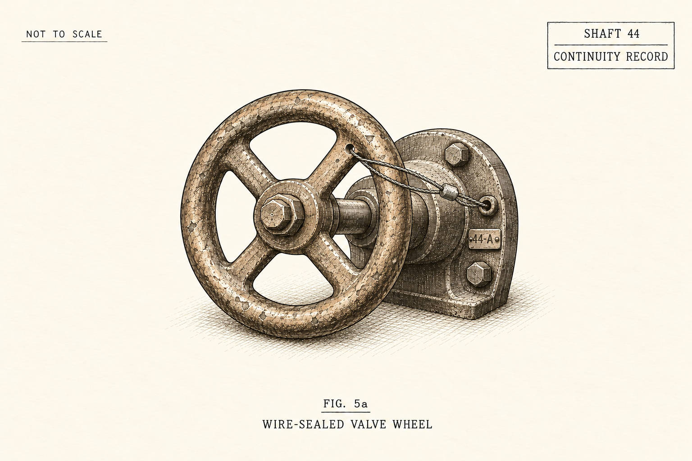

# THE THULANS
## The Weight of a Lie

Aaron Marchant

### CHAPTER FOUR: The Acoustic Trace

“Break it under your heel,” Sanna said.

She had lifted the kettle from the brazier, wrapping her sacking skirt around its hot handle. At the far end of the bunkhouse, the stave Kaelen had strapped over the nursery pump’s crack was still holding. Water slipped through the wire in a slow drip-tap-drip into the gutter.

On the upside-down pine crate between them lay the broken piece of Tier Nine roofing slate, the red wax gleaming dull and wet in the tallow light.

“Break the wax and it’s only roofing slate,” Kaelen said. He sat on an empty grease tub, working a stone along his nicked chisel. Shhk. Shhk. Shhk.

“He’s dead either way.” Sanna watched Harn in the third crate. His mouth hung open between shallow breaths. “We lost the watchman’s dog once. Tomorrow Odo searches the bedding. If he finds that seal, who looks after them?”

“What if we take it to Sub-Deacon Milo?” Bram asked. He sat on the lowest duckboard, his hands hidden inside his sleeves. “Milo read the roll when Wulfila jumped. Maybe Odo locked the valve without telling the church. If Milo sees the survey mark—”

“Whose seal is that?” Kaelen stopped sharpening. “The Board gives the Deacons their orders. Take it to Milo and you’re saving Odo the walk.”

Sanna picked up the iron poker from the hearth bricks. The tip was crusted with white coal ash.

“Give me the stone, Kaelen,” she said. “I’ll scrape the red wax into the clinkers until it melts, and Bram can drop the slate down the latrine bore. Nobody ever has to know we had it.”

Kaelen looked at her poker, then down at the red wax.

“If you melt it,” Kaelen asked, “where do we get tomorrow’s water?”

Sanna’s hand tightened on the iron rod.

“Six pints today. Less when they choose.” He pointed to the pump. “And that patch won’t last the shift. They won’t send a new casing to a condemned drift. They’ll move the workers who can climb and leave us to carry the rest.”

He reached down, picked up the broken slate, and tapped his missing ring finger against the square 44 cut into the wax.

“The surveyor measured water above the spillway at Shaft 44,” Kaelen said. “The supply pipe passes through the old service chamber at the end of our drift. There’s a small draw-off valve beside the main gate. I helped brick up the entrance thirty years ago, when they closed that branch.”

“You knew that valve was there?” Sanna asked.

“I knew the pipe was there.”

“For forty days.”

Kaelen looked at Bram.

“Break a water seal and they hang you. They cut off your hearth.” He reached for the spanner. “I thought the exemption would hold.”

Bram watched him take the iron. “Can we open it?”

“The main gate needs a crew and the key from Tier Eight,” Kaelen said, taking up his pinch-bar. “We only need the little valve. Four bricks out and we can reach it. We hang clean gutter sections along the wall, above the floor ditch, and lead the water into the nursery tank.”

He pointed toward the pump.

“That still takes the dirty water out. We keep the two apart.”

“And when they see the pressure fall?” Sanna asked.

“A little draw might pass unnoticed,” Kaelen said. “We turn it slowly. No more than the gutters can carry.”

Harn’s tongue clicked against his dry mouth. Beside him, the weaver’s newborn had stopped crying. Sanna watched until she saw the ribs move beneath its blanket.

She lowered the poker and took the long box spanner from beside the pump. Kaelen checked its square opening and nodded. She wrapped the iron in flour sacking.

“I’ll turn it,” Sanna said. “Bram can lay the gutters. Marta, keep the cloths damp. Elin, there’s half a barley cake behind the kettle. Share it.”

She went along the three crates, touching each small forehead with the back of her fingers. Harn caught one finger and held it. She waited until his grip loosened before she stood.

“Leave the slate under the bottom hearth-brick,” she told Bram. “If Odo searches the straw, he won’t lift a red brazier with his bare hands.”

Bram knelt at the hearth, then looked at the crossed calipers. He wrapped the slate in a scrap of sacking and slipped it inside his tunic instead.

⁂

Beyond the bricked-up chamber at the end of Drift 14, the floor of the old rescue bay shifted.

Varek had served the deep mine for three hundred years. Forty days earlier, he had stood on the Tier Six Gantry behind Wulfila. Afterward the Board returned him to Caisson Seven, the rescue bay adjoining Shaft 44. A short service passage connected his cradle to the water main. He was to listen for movement in the condemned rock. They left his boiler idling in the dark.

Inside the dark shell, there was no light and no speech. There was only the slow creep of the mountain against the plates, the banked pilot burner, and the smell of ancient mineral grease.

The harness lay tight across his ribs. He shifted what little he could inside it, waiting for the breathing engine’s next stroke.

Through the rock came three taps, a pause, then three more. A smith testing a cap. Farther off, a haulage crew were singing to keep their pull together. Varek had heard the same work-song before their grandfathers were born. One voice kept coming in late.

He waited for it on the next verse.

Deep beneath the chamber, magma shifted. Trapped groundwater flashed to steam, and the rock began to move.

The floor slipped beneath Varek’s cradle.

A tilt-switch tripped. Its striker showered sparks into the burner.

Whump.

The main burner caught with a dull roar. Steam from the walking boiler drove a pump that forced oil into Varek’s joints. A smaller engine, fed by its own pilot burner, kept air moving through his breathing tube. That engine had never stopped.

The chains tightened as his frame took pressure. He felt their pull through the harness.

Varek had not forgotten Wulfila. Afterward he had asked whether the hearth would drink. The clerk had shown him the entry: eight pints. Varek had let the man close the book.

He still saw the boy’s eyes on the Gantry. But first came the bite of the pressure gauge beneath his collarbone, its curved brass tube pressing against old scar tissue as the oil warmed. Deep in his chest, a needle scraped away from its stop.

A check valve opened inside his chest. Warm oil entered the stiff joints. He felt the pressure reach each one.

Varek gasped.

Air came through the brass strainers beneath his chin, past a felt filter that smelled of coal-dust, and down the tube at his throat. The sharp breath rasped through the buried vault.

Khhh-aaaaah.

His eyelids did not open. An arc-flash in the Shaft Nine fire had blinded him two hundred years earlier. Instead, brass shutters clicked aside over the twin quartz lenses in his steel visor.

The chamber appeared in a faint green light. Across the eastern arch, the instruments traced the strain in bright, trembling lines. Mortar fell between the bricks.

A slab struck his shoulder. One suspension chain broke, then its neighbour. The cradle tipped and dropped him onto the floor.

Three tonnes of iron struck stone.

His heels skidded through fallen mortar before catching against the cradle’s base. The harness struck his lower back. Pain ran up his spine into his jaw.

He waited until he could draw another breath.

He raised his left gauntlet and brushed the old stamping behind his chest guard: ORA ET LABORA.

Oil hissed from the dry seal along his forearm. His five steel fingers closed around the Fault Maul: thirty kilograms in all, with a broad striking face and a curved splitting beak. Its old foundry mark remained clear:

FORTIS ET LIBER.

On his right forearm, the folded Faírg-Tygil stirred. Its three bronze-collared claws listened to vibrations in the rock, trembling in time with the cracking wall.

He lifted the maul from its rack. The head dipped, then steadied as pressure reached his elbow.

Continuity had ordered him to hold this post until the lower workings were empty. They were not empty. The men who sent him here had the clearance lists. He had waited for their word.

Ahead, through the service passage, a woman told a boy to keep his hands clear.

A pipe joint tore open in the chamber. Water struck the brickwork separating it from the drift.

Varek broke his post.

Varek followed the passage to the water main. A split inspection pipe was filling the chamber. Its shutoff lay beneath fallen stone banked against the bricked-up outer arch. The sealed main gate stood beyond it. Through the brickwork, he could hear Kaelen’s chisel.

“Clear the wall,” Varek called. The water drowned his voice.

He struck the arch beside him three times. Beyond it, the tools stopped. Boots scraped across stone.

The arch was shedding bricks into the passage. Bringing it down outward would let the banked stone spill into the drift, clearing the shutoff. The stone sill beneath the opening should turn the water into the waste channel. He heard Kaelen calling the others back, then braced his feet and raised the maul.

⁂

Bram held the candle behind Kaelen. The smith had two bricks out when three heavy taps shook his chisel.

Kaelen let the chisel rest. Mortar sifted from the arch. Through the water, Bram heard something like a voice.

“Back!” Kaelen roared, grabbing the collar of Bram’s wool tunic with his left hand and the shoulder of Sanna’s shawl with his right, hauling both of them backward over the rusted rail coupling.

Bram pushed the candle into a split in the post behind them.

The first blow rang through the wall. Kaelen pulled the others farther back.

A crack split the wall from the roof beam to the floor. Red mortar dust burst into the drift.

BOOM.

The arch fell outward in a rush of red brick and white water.

The stone sill broke with the wall. Water struck the sleepers, lifted loose ballast, and raced down the grade toward Lower Four.

“The nursery!” Sanna shouted. Her nails dug into Kaelen’s arm. “It’s going down to the nursery!”

“The bypass!” Kaelen roared through the spray. “Sanna, open the waste gate with your box spanner! Bram, lift that oak drop-board! Send the flood into the waste flume or it’ll drown the nursery!”

Sanna lunged for the waste-gate spindle. Bram caught the handles of the oak board and pulled upward, his boots skidding over loose stone.

The flood scoured clay from beneath the nearest roof post.

The post shifted. A long white split opened in the beam above Sanna, and the roof began to settle.

“Sanna!” Bram shrieked.

Varek stepped through the spray.

Sanna was bent over the gate. As the beam dropped, Varek turned from the broken pipe.

Before the splitting timber cap could crush Sanna into the mud, Varek drove his iron shoulder straight up into the falling log.

CRACK.

His frame groaned under the load. His heels slid in the washed-out track bed until one caught against a rail.

The lenses turned past Kaelen’s raised hammer and stopped on the pine sprig at Bram’s chest.

A valve beneath his chin clicked. The bronze speaking plate moved, shaping his breath into words.

“Your timber cap is splitting,” Varek Fairgunjis said, his bronze voice vibrating through the water in the ditch. “Move the child back three paces. I will take the roof.”

  

