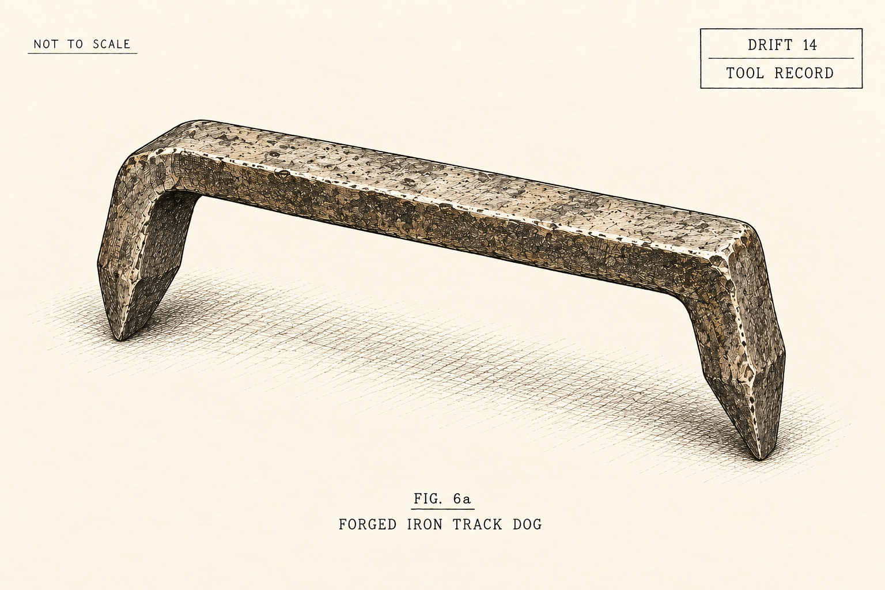

# THE THULANS
## The Weight of a Lie

Aaron Marchant

### CHAPTER FIVE: The Shoring of Drift 14

Kaelen did not kneel. He looked at Varek’s feet, as he would at any crane settling on bad ground.

“The larch prop, boy! Sanna’s got the waste gate open. Help her with that timber. We have to take the roof off him.”

Bram dragged the spare larch timber from the flat-car. Sanna got her shoulder beneath one end, and together they hauled it through the freezing spray. Bark tore at their sleeves.

The roof beam bowed across Varek’s right shoulder. A white splinter peeled from it and fell across his visor. If the beam split, the rock above it would follow.

As Kaelen helped them heave the prop upright, Bram saw the needle falling on the gauge beside Varek’s neck. Oil misted from his shoulder.

“The right-shoulder seal’s gone!” Kaelen shouted.

Varek’s boots shifted in the loose ballast. One caught against a rail, and the beam moved with him.

“Seat the prop’s foot,” he said. “Right leg lock broken. I cannot lower the beam much farther.”

Kaelen dropped to his good knee. He set an oak plate beneath the prop to keep it from sinking into the mud, then worked its notched top under the beam.

“Wedges!”

Sanna took two iron wedges from the basket and pushed them between the plate and the foot of the prop. Kaelen drove them home with his sledge. Each blow tightened the timber beneath the roof; fresh resin squeezed through its bark.

“Easy now. Let the prop take it.”

Varek lowered his shoulder. The timber creaked as the weight came onto it, and Bram watched the long split in the beam.

The ceiling held.

Varek went back through the breach and forced the inspection pipe’s shutoff closed. The roar dwindled to the wash of water draining from the chamber.

Oil and black silt covered the sleepers. Fallen timber trapped a deep pool at the entrance, but farther down, the open waste gate carried the dirty water past the nursery branch.

When Varek returned, Bram saw the full eight-foot bulk of him. His plates were pitted and scarred, green around the bronze fittings. They looked nothing like the polished statues above. Soot almost hid the old foundry crest on his chest.

The shutters behind his visor clicked. His lenses settled on the pine sprig behind Bram’s three brass pins. The needles were soaked black.

The bronze throat-plate scraped forward.

“You stood behind the rope.”

Beneath the metal rasp, Bram heard the thin voice of an old man.

“Tier Six. Forty days ago.”

Bram pressed his knuckles against the wet pine. His throat tightened.

“You were standing behind the Sub-Deacon.”

“They brought me to stand behind the gate,” Varek said. “So two thousand people would believe I approved.”

His visor turned toward Sanna, who still held the wrapped spanner in her red hands.

“He believed the surrender bought his family water for the rest of their lives.”

“Two days,” Sanna said. “Then the roof buried our tap. We brought the exemption here, but now Odo says the pipe no longer exists. Six pints this morning. Unless we pay for a petition.”

She pointed her spanner toward the sealed gate beyond the breach.

“And the water was here all along.”

Gate 44-A stood in the chamber, its bronze wheel locked and wire-sealed. Beside it, the smaller draw-off valve sat above the flood mark. Dirty water had not reached its outlet. Below it, the broken inspection pipe was quiet.

Varek rested his right talons against the supply pipe.

“The shipyard pumps run through the night,” he said. “I hear them through the rock. The lower taps go quiet. The pumps do not.”

Bram took the wrapped slate from his tunic and held it out. Kaelen checked its marks against the pipe.

“Eight hundred and twenty tonnes of plate,” the smith said. “We rolled it curved. I asked what waterworks needed plates that size.”

He looked toward Lower Four.

“The six hulls on the wall. They’re real.”

Bram looked from the slate in Kaelen’s hand to Varek.

“Why keep it from us? If there was water, why did he have to go?”

“The ships’ boilers need clean water,” Varek said. “The magma is rising beneath the lower workings.”

“An exit,” Kaelen said.

“Six hulls,” Varek said. “Six hundred thousand berths between them.”

“Who told you that?” Kaelen asked.

“They read the loading schedule behind the choir-gate. Before the crowd came in.”

Sanna’s hands tightened around the spanner.

“Six hundred thousand?”

She looked down the dark drift toward Lower Four.

“There are four point two million of us.”

Water dripped from the sacking around her hands.

“One in seven.”

“Yes,” Varek said.

Kaelen handed the slate back to Bram. Wulfila had held it before him. The water had been there then, too.

Sanna brought the clean gutter sections to the draw-off outlet. Bram wiped their insides and tied them along the wall, well above the ditch. Kaelen checked each joint. The last section reached the mouth of the old feeder pipe leading to the nursery tank.

Kaelen touched the wire seal on the little valve. “Break this and they’ll know whose hearth took the water.”

“They know our names,” Sanna said. “Help me turn it.”

Kaelen cut the seal. He and Sanna fitted the spanner over the square stem and took an end each. Varek steadied the first gutter while Bram tightened its binding.

Together they leaned on the spanner. The stem held, then gave a little beneath their hands.

“Easy,” Kaelen said.

Rusty water spat from the outlet. Bram kept the last gutter turned toward the ditch while it washed through. He watched the brown thin to yellow, then disappear.

“Now.”

He swung the gutter into place. Water entered the feeder with a hollow knock and a rush that travelled down the pipe. Sanna eased the valve back until the stream sat below the gutter’s rim.

They listened.

From Lower Four came a shout. Then Marta’s voice, calling for the clean pail.

Bram looked at Sanna. She was still holding the spanner, her cheek wet with spray.

“Can I?”

“Drink.”

A thin spill escaped the first joint. Bram held his hands beneath it, clear of the gutter. Black lines washed from his palms into the ditch. He let them run clear, then cupped them and bent his mouth to the water.

The cold hurt his teeth. He swallowed and filled his hands again. There was no boiler taste.

Sanna steadied the gutter while he drank. When he straightened, water ran down his wrists into his sleeves.

Below them, someone laughed. The sound stopped almost at once. A pail struck stone, and Marta called for another.

Sanna loosened one hand from the spanner. Her fingers were shaking. Then a bell sounded above them.

Its first slow stroke travelled down the haulage shaft.

CLANG.

A four-second pause. Then two sharp, frantic clangs:

CLANG-CLANG.

“The main alarm,” Kaelen said. “The burst pipe must have tripped it. They’ll come looking for the break.”

A whistle sounded at the haulage entrance. Chains scraped over stone, coming closer.

Pit-mastiffs.

“Odo’s day-patrol,” Sanna said, her knuckles turning white around the wrapped spanner. “They were at the Tier Seven tool-crib when the bell struck.”

“They’ll bring a demolition crew,” Kaelen said. “If they can’t retake the valve, they’ll bring the roof down over it.”

Varek reached down into the slurry with his left gauntlet and lifted the Fault Maul.

The maul’s broad head rose from the water, dripping grease. Oil hissed through the working joint in his left arm.

“Take the boy,” Varek told Sanna. “Get the clean flow into the tank. Keep the waste gate open. Let the hearths drink.”

“Varek.” Kaelen stepped in front of the iron giant, sledge raised. “You’ve one good ram left and barely enough stroke to walk. They’ve got four carbines and two mastiffs.”

Varek stepped over a loose packing block into the centre of the track.

“Then bring your cold chisel, smith,” Varek rasped through his bronze plate. “I have not worked with a crew in three hundred years.”

  

